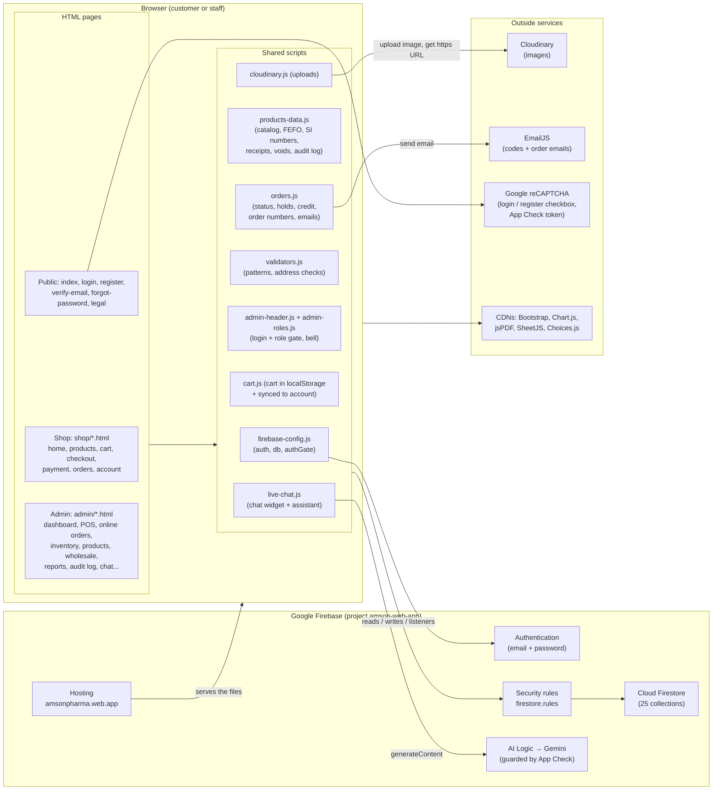
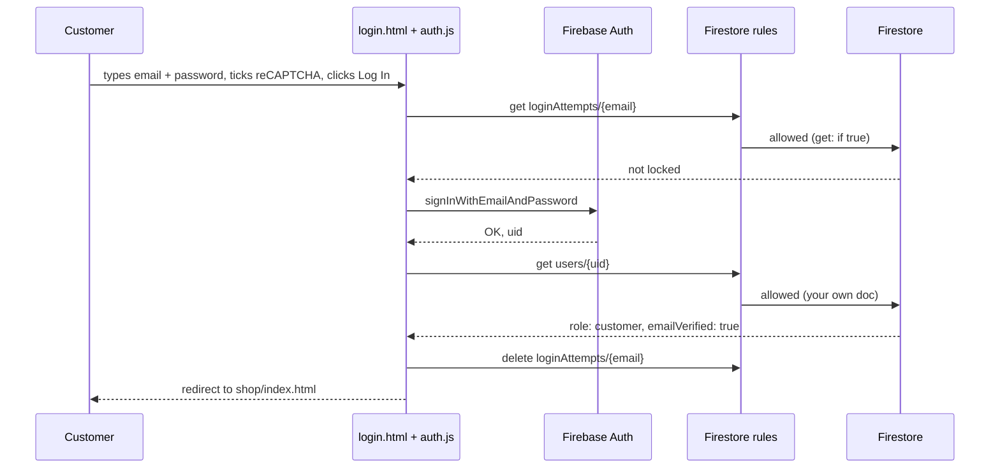
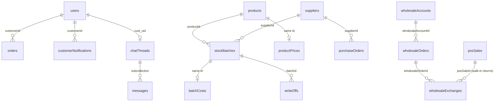

# 01 - Architecture: The Big Picture

This file shows how everything connects: pages, scripts, Firebase and the outside services. Then it
lists every database collection and who may touch it. It ends with every role: what each can do, and where that's enforced.

---

## 1. One-sentence summary

**Amson is a "serverless" web app.** Every page is a plain HTML file. Its JavaScript talks **directly** to
Firebase (logins and database) and to a few outside services (images, email, AI chat). **Firebase security rules**
are the gatekeeper that decides what each person may read or write.

There's no server of our own (no PHP, no Node backend). This was chosen because:
- the client is one pharmacy branch with a small budget: Firebase's free Spark plan, Cloudinary free tier and EmailJS free tier cost ₱0 a month;
- there's no server to patch, back up or keep running;
- Firebase gives us live updates (listeners) for free, so the online order queue updates by itself.

The trade-off: the browser can't be trusted, so **every important limit has to be repeated in the security rules**.
Things the rules can't express (like checking an email code) are known limitations (see `13-security.md`).

---

## 2. The system diagram

**How to explain the arrows:**
- Hosting sends the files to the browser.
- Every database request passes through the **rules** first. Allowed requests reach Firestore; others get `permission-denied`.
- Images go to **Cloudinary**. We save only the returned link (`https://res.cloudinary.com/wb6wxped/...`) in Firestore.
- Emails go out through **EmailJS** straight from the browser.
- The chat sends a question to **Gemini** through Firebase AI Logic. **App Check** must vouch for our website first.

---

## 3. A request, start to finish (example: customer logs in)

---

## 4. The Firestore data structure

There are **25 collections** (24 top-level plus one subcollection). For each one: the main fields, which code
writes and reads it, and what the rules allow. Rule helper names come from `firestore.rules:6-33`:

- `isSignedIn()`: anyone logged in.
- `isStaff()`: logged in, with role `admin`, `branch_manager`, `technical_staff` or `sales_staff`, and **not deactivated** (this is re-checked on every request, so a deactivated staff member loses access immediately).
- `isManager()`: active `branch_manager` or `admin`.
- `isOpsStaff()`: active staff **except** `sales_staff`.

### 4.1 People and accounts

| Collection | Main fields | Written by | Read by | Rules (`firestore.rules`) |
| --- | --- | --- | --- | --- |
| **`users/{uid}`** | `firstName, lastName, email, contactNumber, role, accountStatus, emailVerified, emailVerificationCode, emailVerificationExpiresAt, creditBalance, lastCreditOrderId, cart, cartUpdatedAt, shippingAddress, trustedDevices, emailNotifications, photoUrl, createdAt` | `register.js` (sign-up), `verify-email.js`, `account-settings.js`, `cart.js` (cart sync), `checkout.js` (saved address), `admin-staff-management.js`, `admin-customer-accounts.js`, `orders.js` (credit) | almost every page | 36-64: read your own doc, or any doc if ops staff. **Create**: a customer may create only their own doc with `role: "customer"` and `creditBalance` 0; a manager may create staff docs. **Update**: your own doc, but you can't change `role` or `accountStatus` or *raise* your `creditBalance`. Managers may update anyone; other ops staff only customer docs. **Delete**: never (except the temporary clear-test-data rule). |
| **`loginAttempts/{email}`** | `count, lockedUntil` | `auth.js` (failed logins) | `auth.js` | 353-374: anyone may *get* one email's doc (needed before login). Create only with count 1; update only `count + 1`, never while locked, with `lockedUntil` at most 3 minutes ahead. Delete: the signed-in owner, an expired lock, or a manager. Only managers can *list* them, because the doc names are emails. |
| **`notifications/{staffUid}`** | `read: { key: signature }` (which staff alerts each person has read) | `products-data.js` `markStaffNotifRead` | admin bell | 248: ops staff only |
| **`customerNotifications/{id}`** | `customerId, title, detail, link, severity, read, kind, createdAt` | `orders.js` `notifyCustomer` (staff actions), `payment.js` (order placed) | shop bell (`shop-header.js`) | 190-209: customers read their own; only staff create, except the customer's own `order_placed` notice with exactly the allowed fields. Customers may only flip `read`. No deletes. |

### 4.2 Catalog

| Collection | Main fields | Written by | Read by | Rules |
| --- | --- | --- | --- | --- |
| **`products/{id}`** | `name, genericName, brand, category, retailPrice, reorderPoint, description, dosageNotes, shopSection, imageUrl, availableInPOS, availableInOnlineStore, rxRequired, status, priceLocked, pricePending, sku, createdAt` | `admin-products.js`, `admin-product-photos.js`, quick-add in `admin-inventory.js` | everyone (`loadCatalogCache`) | 85-102: public read. Branch Manager may create/update anything. Other ops staff may create only with **all prices 0, `pricePending: true`, `status: "inactive"`**, and may update only if **price fields don't change** and they don't make a price-pending product active. Sales Staff can't write. |
| **`productPrices/{productId}`** | `costingPrice, wholesalePrice, updatedAt` | `setPrivatePrices` (`products-data.js:971`) | staff pages only (`loadPrivatePrices`) | 105-110: staff read; only the Branch Manager writes, and only those 3 fields. This keeps cost and wholesale prices **out of the public product docs**. |
| **`categories/{slug}`** | `name` | `admin-products.js` `addCategory` | everyone | 119-122: public read, ops staff write (the page only lets the Branch Manager add). |
| **`storeSettings/homeBanner`** | `active, kind, message, updatedAt` | `admin-store-banner.js` | `store-info.js` (shop banner) | 113-117: public read; Branch Manager, Technical Staff or Admin write. |

### 4.3 Stock

| Collection | Main fields | Written by | Read by | Rules |
| --- | --- | --- | --- | --- |
| **`stockBatches/{id}`** | `productId, batchNo, expirationDate, quantity, initialQuantity, status ("active" / "wholesale_only" / "bad_order"), supplierId, supplierReceiptNo, dateReceived, poId, source, deliveries[], badOrderQty, badOrderAt, disposedAt, disposedBy, disposalNote, lastAdjustedAt` | receiving (`admin-inventory.js` `applyStockReceipt`), opening stock, every sale (`deductStockFEFOOnce`), voids, exchanges, write-offs, stock count, expiry rules | shop (stock numbers), POS, inventory, reports | 213-217: **public read** (the shop needs real stock); any staff may *update* (the POS needs to reduce quantity); ops staff create/delete. |
| **`batchCosts/{batchId}`** | `unitCost, deliveryCosts[]` | `applyStockReceipt` | reports (`attachBatchCosts`) | 219-221: ops staff only. Keeps purchase cost private. |
| **`writeOffs/{id}`** | `batchId, productId, batchNo, quantity, reason, writeOffDate, automatic, fromCustomerReturn, createdAt` | `saveWriteOff`, `markBatchBadOrder`, walk-in returns set aside | Pull-Out report | 229: ops staff |
| **`reconciliations/{id}`** (stock counts) | `rcnNumber, period, status, items[{batchId, productId, batchNo, systemQty, countedQty, variance}], openedBy, countSavedBy, finalizedBy, finalizedAt, varianceReason` | inventory stock count | inventory, Monthly Inventory report | 228: ops staff |
| **`suppliers/{id}`** | `name, contactPerson, phone, email, address, status` | `admin-suppliers.js`, quick-add | inventory, reports | 226: ops staff |
| **`purchaseOrders/{id}`** | `poNumber, supplierId, expectedDeliveryDate, items[], status, receivingRecord, receivedAt` | inventory (create, receive) | inventory, PO Discrepancy report | 227: ops staff |

### 4.4 Sales

| Collection | Main fields | Written by | Read by | Rules |
| --- | --- | --- | --- | --- |
| **`orders/{id}`** (online) | `orderNumber, customerId, contact{}, shipping{}, deliverySchedule, items[{id, name, price, qty, imageUrl, batches}], subtotal, total, creditApplied, proofOfPaymentUrl, paymentReferenceNumber, requiresPrescription, prescriptionPhotoUrl, status, statusTimestamps{}, invoiceNo, verification{}, paymentIssue{}, paymentOverage{}, trackingLink, lalamoveFee, closedReason, unappliedCredit, createdAt` | `payment.js` (create), `admin-online-orders.js` (every staff step), `order-details.js` (customer resubmit / received), `orders.js` (deadline, auto-deliver) | customer's My Orders, staff Online Orders, dashboard, reports | 131-178: customers read their own. **Create** only for yourself, `status: "placed"`, total ≥ 0, none of the staff-only fields, photo links must be our Cloudinary, and store credit must come off your balance **in the same write**. **Customer updates** only: delivered → received; dispatched → delivered after 3 days; or resubmitting a hold fix (only the photo/reference fields). Ops staff update anything. **No deletes.** |
| **`posSales/{id}`** (walk-in) | `invoiceNo, customerName, items[{productId, name, price, qty, batches, voidedQty, returnedQty}], total, paymentMethod, referenceNo, cashReceived, change, cashier, branch, rxVerified, rxNotes, voided, voidReason, voidedBy, voidApprovedBy, partialVoids[], createdAt` | `admin-pos.js`, `voidPosSale`, walk-in exchanges | POS, online orders "Walk-in" tab, dashboard, reports | 222-225: any staff read/create (Sales Staff ring up sales); only ops staff update (voids, returns). |
| **`wholesaleAccounts/{id}`** | `name, contactPerson, businessType, phone, email, address, ltoDocumentUrl, permitDocumentUrl, ltoValidUntil, permitValidUntil, agreedPrices{}, status` | `admin-wholesale-accounts.js` | wholesale page | 230: ops staff |
| **`wholesaleOrders/{id}`** | `invoiceNo, wholesaleAccountId, buyerName, items[], total, paymentMethod, freeOfCost, freeOfCostReason, poRefNumber, poDocumentUrl, releaseStatus, releasedAt, releasedBy` | `saveWholesaleOrder` | wholesale page, reports | 231: ops staff (no delete) |
| **`wholesaleExchanges/{id}`** (wholesale **and** walk-in returns) | `kind, exchangeNo, wholesaleOrderId / posSaleId, invoiceNo, buyerName, restocked, returned{}, replacement{}, priceDifference, reason, processedBy` | `processWholesaleExchange`, `saveWalkinExchange` | Return/Exchange report | 232: ops staff |
| **`prescriptionOrders`** | old records only | nothing now | old records | 182-188: kept for history |

### 4.5 Counters, chat and the log

| Collection | Main fields | Written by | Rules |
| --- | --- | --- | --- |
| **`counters/{id}`** | `count`. Ids: `orders-2026`, `salesInvoices`, `products`, `purchaseOrders-2026`, `reconciliations-2026`, `wholesaleExchanges` | `generateOrderNumber`, `deductStockFEFOOnce`, `generateProductSku`, etc. | 308-322: signed-in users read. `salesInvoices` may only go **up by exactly 1**, by staff. `orders-YYYY` may only go up by 1 (customers bump it at checkout). Other counters: staff. |
| **`auditLog/{id}`** | `action, details, user, ipAddress, createdAt, record, before, after, reason` | `logAuditEvent` (`products-data.js:2375`) from every important action | 235-246: ops staff read; any staff create; customers may only log "Order Received by Customer" / "Order Auto-Delivered" with a short detail and the server time. **No updates or deletes** (append-only). |
| **`chatThreads/{threadId}`** | `lastMessage, lastMessageAt, customerName, kind, customerId, status ("ai" / "waiting_staff" / "staff" / "resolved"), unreadByStaff, handoffReason, handoffAt, createdAt` | `live-chat.js`, `admin-live-chat.js` | 252-281: the id must be `cust_<your uid>` or a random `guest_` id. Customers create only with `status: "ai"` and short text; they may only switch between `ai` and `waiting_staff` (they can't take a chat away from staff). Ops staff list and update. |
| **`chatThreads/{id}/messages/{id}`** | `sender, text, createdAt, cards` | both chat scripts | 283-294: the owner or ops staff read; customer side may add `customer` / `assistant` / `system` messages up to 2,000 characters and 20 cards; never edited or deleted. |
| **`chatUsage/{yyyy-mm-dd}`** | `count, updatedAt` | `claimChatAiQuota` (`live-chat.js:556`) | 297-304: anyone reads; create only with count 1; update only +1. |

> **Temporary rule (`firestore.rules:324-349`)**: until **15 Nov 2026** a Branch Manager may delete test data
> (orders, sales, stock, logs, test users, etc.) using `admin/clear-test-data.html`. After that date the rule
> switches itself off (`request.time < timestamp.date(2026, 11, 15)`). The page has the same date in
> `CLEAR_TEST_DATA_UNTIL` (`js/admin-roles.js:33`). Plan: remove both after go-live.

### 4.6 How the main collections relate

Sold items remember **which batches** they came from (`items[].batches`). That's how voids and returns put
units back in the right batch, and how the Daily Sales report shows batch numbers.

---

## 5. Roles and permissions

### 5.1 The roles

| Role (stored in `users.role`) | Label | Lands on after login |
| --- | --- | --- |
| `customer` | Customer | `shop/index.html` (or the shop page they came from) |
| `sales_staff` | Sales Staff | `admin/pos.html` |
| `technical_staff` | Technical Staff | `admin/dashboard.html` |
| `branch_manager` | Branch Manager | `admin/dashboard.html` |
| `admin` | Administrator (older name, treated like Branch Manager) | `admin/dashboard.html` |

Labels and landing pages come from `js/admin-roles.js:3-38` (`STAFF_ROLE_LABELS`, `homePageForRole`).

### 5.2 What each role can open (UI)

From `ADMIN_PAGE_ACCESS` (`js/admin-roles.js:12-30`):

| Page | Sales | Technical | Branch Mgr / Admin |
| --- | :-: | :-: | :-: |
| POS | ✓ | ✓ | ✓ |
| Products (catalog) | ✓ view only | ✓ no prices | ✓ |
| Settings (own profile/password) | ✓ | ✓ | ✓ |
| Dashboard, Online Orders, Inventory, Suppliers, Customer Accounts, Wholesale, Audit Log, Notifications, Live Chat, Reports | ✗ | ✓ | ✓ |
| Staff Management | ✗ | ✗ | ✓ |
| Clear Test Data (temporary) | ✗ | ✗ | ✓ |

### 5.3 What each role can do, and where it's enforced

| Action | Who | Enforced in the page (UI) | Enforced in the rules (server) |
| --- | --- | --- | --- |
| Browse shop, cart | Anyone (guests too) | none needed | `products`, `stockBatches`, `categories` are public read |
| Place an online order | Logged-in customer | `checkout.js:145` / `payment.js:67` send guests to login | `orders` create: `customerId == myUid()` and `status == "placed"` |
| See an order | The customer who owns it, ops staff | My Orders only lists your own | `orders` read: own or `isOpsStaff()` |
| Ring up a walk-in sale | All staff | POS page open to all staff | `posSales` create: `isStaff()`; `stockBatches` update: `isStaff()` |
| Void / return a walk-in sale | Technical (needs BM password), Branch Mgr | `roleCanVoidSales` (`products-data.js:1483`); approval dialog for Technical Staff (`admin-pos.js:473`) | `posSales` update: `isOpsStaff()` (the BM approval itself is page-only, see limitations) |
| Approve online payments | Technical, Branch Mgr | Online Orders page hidden from Sales | `orders` update: `isOpsStaff()` |
| Set or change prices | Branch Mgr only | `canEditPrices()` disables price boxes (`admin-products.js:76`) | `isPriceManager()` on `products`; `priceFieldsUnchanged()` for others; `productPrices` write manager only |
| Add a product | Technical, Branch Mgr | Add button hidden for Sales (`admin-products.js:70`) | Technical Staff's new products must be price 0, `pricePending`, inactive |
| Finalize a stock count | Branch Mgr | `canFinalize` (`admin-inventory.js:1607`); others "save for the manager" | page-only (rules let ops staff update batches) |
| Add a category | Branch Mgr | `addCategory` check (`admin-products.js:1062`) | rules allow ops staff (page restricts it) |
| Manage staff | Branch Mgr | page access list | `users` create staff / update: `isManager()` |
| Deactivate a customer | Technical, Branch Mgr | Customer Accounts page | ops staff may update only `role == "customer"` docs |
| Read the audit log | Technical, Branch Mgr | page access list | `auditLog` read: `isOpsStaff()` |
| Delete audit log entries | Nobody | none | `allow update, delete: if false` |

### 5.4 The two layers, explained simply

1. **The page layer (UI)** hides buttons and pages a role shouldn't use. Every admin page runs the gate in
   `js/admin-header.js:13-71`:
   - not logged in → go to login;
   - no staff role → go to the shop;
   - deactivated → signed out;
   - page not allowed for this role → "You don't have access to that page" and sent to their home page;
   - otherwise the page is shown (`admin-ready` class) and `admin:ready` fires.
   Until then the page body stays hidden, so nothing flashes on screen.
2. **The rules layer** is the real lock. Even if someone opens the browser console and calls Firestore
   directly, the rules check their role **on Google's server** (`myRole()` reads their `users` doc on every request).

> **The sentence to say at the defense:** "The interface hides what a role can't use, but the real
> enforcement is in Firestore security rules, which run on Google's servers. So even someone who edits our
> JavaScript in the browser console can't read other customers' orders, change prices without being a
> Branch Manager, or delete the audit log."
