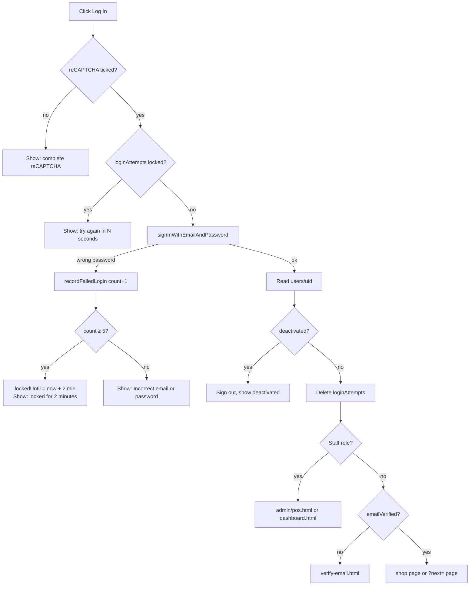
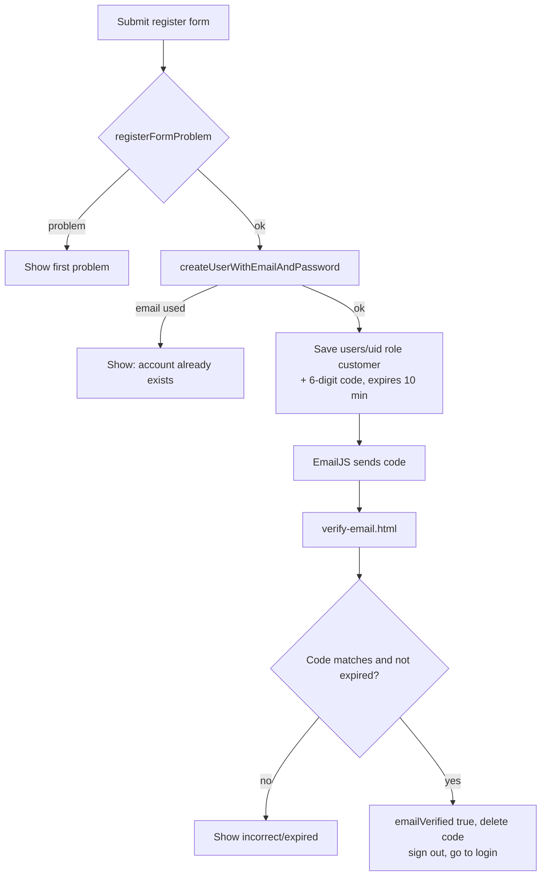

# 02 - Login, Register, Email Code (OTP), Lockout and Role-Based Access (RBAC)

**Files:** `login.html` + `js/auth.js`, `register.html` + `js/register.js`, `verify-email.html` + `js/verify-email.js`,
`js/otp.js`, `js/device-trust.js`, `js/validators.js`, `js/forgot-password.js`, `js/firebase-config.js` (login memory),
`js/admin-header.js` + `js/admin-roles.js` (staff gate), `firestore.rules` (users, loginAttempts).

---

## 1. What it does and why Amson needs it

- **Register** lets a customer create an account so they can order online, track orders, and keep store credit.
- **Email code (OTP)** proves the email is real and belongs to the person. A pharmacy sends order updates and
  prescription results by email, so a fake or mistyped email would mean lost orders.
- **Login lockout** (5 wrong passwords → locked 2 minutes) slows down password guessing.
- **reCAPTCHA** stops simple bots from mass-registering or guessing passwords.
- **RBAC (role-based access control)** matters because a pharmacy has different jobs:
  - the cashier (Sales Staff) should only ring up sales;
  - the pharmacist/technical staff handle stock and orders;
  - only the Branch Manager sets prices, finalizes counts and manages staff.
  This protects the business from mistakes and from insider fraud.
- **Deactivation** lets the manager cut off a staff member who leaves, immediately.

---

## 2. Walkthrough

### 2.1 Register (`js/register.js`)

1. The customer fills the form. While typing, **live hints** appear (`wireLiveHint`, `register.js:37-61`):
   - names must match `NAME_PATTERN` (letters, spaces, `Ma.`, `Anne-Marie`), `js/validators.js:7`;
   - the email must match `EMAIL_PATTERN` and not be a throwaway domain (`isDisposableEmail`, `validators.js:33`);
   - the phone must be a PH mobile number, `09xxxxxxxxx` or `+639xxxxxxxxx` (`PH_PHONE_PATTERN`, `validators.js:14`);
   - the password needs 6+ characters with a letter, a number and a symbol (`PASSWORD_PATTERN`, `validators.js:4`).
2. On submit (`register.js:123`):
   ```js
   e.preventDefault();
   const problem = registerFormProblem();
   if (problem) { showAlert(problem); return; }
   setLoading(true);
   try { await createCustomerAccount(); }
   catch (error) { showAlert(mapAuthError(error)); grecaptcha.reset(); }
   finally { setLoading(false); }
   ```
   - `preventDefault()` stops the page from reloading.
   - `registerFormProblem()` (`register.js:145-190`) returns the **first** problem as a sentence, or `null`. It also checks the Terms box and that reCAPTCHA was ticked (`grecaptcha.getResponse()`).
   - `mapAuthError` turns Firebase codes like `auth/email-already-in-use` into friendly text (`register.js:109-120`).
3. `createCustomerAccount()` (`register.js:193-227`):
   ```js
   const credential = await auth.createUserWithEmailAndPassword(email, passwordInput.value);
   const otpCode = generateOtpCode();
   const otpExpiresAt = Date.now() + OTP_CODE_TTL_MS;
   await db.collection("users").doc(credential.user.uid).set({
     firstName, lastName, email, contactNumber, role: "customer",
     emailVerified: false, emailVerificationCode: otpCode, emailVerificationExpiresAt: otpExpiresAt,
     createdAt: firebase.firestore.FieldValue.serverTimestamp(),
   });
   codeSent = await sendOtpEmail(email, otpCode, firstName);
   window.location.href = "verify-email.html";
   ```
   - First Firebase Auth creates the **login** (email + password).
   - `generateOtpCode()` (`js/otp.js:5`) makes a random 6-digit number: `Math.floor(100000 + Math.random() * 900000)`.
   - The code expires in **10 minutes** (`OTP_CODE_TTL_MS`, `otp.js:3`).
   - The **profile** document is saved at `users/{uid}` with `role: "customer"`. The rules only allow a self-created doc with role customer and 0 credit (`firestore.rules:42-44`), so nobody can sign up as staff.
   - `sendOtpEmail` (`otp.js:9`) sends the code through **EmailJS**. If the email fails, the account still exists and the next page offers "Resend".

### 2.2 Verify the email (`js/verify-email.js`)

- Six boxes; typing jumps to the next box, Backspace goes back, and pasting a 6-digit code fills all of them (`verify-email.js:35-61`).
- `verifyCode` (`verify-email.js:63-119`):
  1. reads the user's own doc;
  2. checks the code exists and hasn't expired;
  3. compares it with what was typed;
  4. if correct, sets `emailVerified: true`, deletes the code fields, and trusts this device;
  5. a brand-new account is signed out and sent to login with "Your account is verified. Please log in" (`verify-email.js:105-112`).
- "Resend" makes a new code and saves it (`verify-email.js:131-158`).

### 2.3 Log in (`js/auth.js`)

`performLogin(email, password)` at `auth.js:116-179`, step by step:

| Step | Code | What it does |
| --- | --- | --- |
| 1 | `grecaptcha.getResponse()` (`auth.js:119-124`) | No tick on reCAPTCHA → "Please complete the reCAPTCHA verification." |
| 2 | `getActiveLoginLock(email)` (`auth.js:66-79`) | Reads `loginAttempts/{email}`. If `lockedUntil` is in the future → "Too many failed attempts. Please try again in N seconds." If the lock has expired, delete it. |
| 3 | `auth.setPersistence(LOCAL)` + `markLoginRemembered(rememberMe)` (`auth.js:136-137`) | Remember Me: keep the login after the browser closes, or end it. |
| 4 | `auth.signInWithEmailAndPassword` (`auth.js:139`) | Firebase checks the password. |
| 5 | read `users/{uid}` (`auth.js:140`) | No profile → sign out. `accountStatus === "deactivated"` → sign out, "Your account has been deactivated." |
| 6 | `clearLoginAttempts(email)` (`auth.js:155`) | Successful login wipes the failed counter. |
| 7 | device check (`auth.js:157-161`) | Only if `REQUIRE_DEVICE_CODE` is on (it's **off**, see below). |
| 8 | `redirectByRole(userData)` (`auth.js:97-108`) | Staff → `admin/pos.html` or `admin/dashboard.html`. Unverified customer → `verify-email.html`. Customer → `shop/index.html` or the safe `?next=` page. |

On a wrong password (`auth.js:163-171`):
```js
if (["auth/wrong-password", "auth/user-not-found", "auth/invalid-credential"].includes(error.code)) {
  const newLockedUntil = await recordFailedLogin(email).catch(() => null);
  if (newLockedUntil) showAlert("Too many failed attempts. Your account is locked for 2 minutes.");
  else showAlert(mapAuthError(error));
}
```
- `recordFailedLogin` (`auth.js:81-91`) adds 1 to `count`; at **5** (`LOGIN_LOCKOUT_THRESHOLD`, `auth.js:56`) it saves `lockedUntil = now + 2 minutes` (`LOGIN_LOCKOUT_MS`, `auth.js:57`).
- `.catch(() => null)`: if the rules refuse the record (e.g. the phone's clock is wrong), the user still gets the normal "Incorrect email or password" message.
- The doc id is the email in lowercase (`loginAttemptsDocId`, `auth.js:61-63`), so `Juan@Test.ph` and `juan@test.ph` count together.
- The message is the same for "no such user" and "wrong password" (`auth.js:45-48`), so attackers can't tell which emails exist.

**`loginNextPage()`** (`auth.js:111-114`) only accepts `?next=` values that look like `shop/something.html`.
This blocks an **open redirect**, where an attacker's link would send people to another website after logging in.

### 2.4 "Remember me" (`js/firebase-config.js:33-86`)

- The login is always saved locally (so it's shared across tabs). If Remember Me is **off**, a cookie without an
  expiry date (`amsonBrowserSession`) is set; browsers delete such cookies when they close.
- On the next visit, `authGate` (`firebase-config.js:61-74`) checks: "Remember Me was off **and** the cookie is gone"
  → sign out. Every page waits for `authGate` before listening for the user, so nothing loads half-logged-in.

### 2.5 New-device code (built, currently switched off)

`js/device-trust.js:4`: `const REQUIRE_DEVICE_CODE = false;` (a team decision). When turned on:
- each browser gets a random 24-character id in localStorage;
- logging in from a browser not in `trustedDevices` emails a 6-digit code (`auth.js:216-239`);
- 5 wrong codes cancels the login (`auth.js:264-268`), and a new code can be requested once a minute.
Today `isDeviceTrusted()` simply returns `true` (`device-trust.js:27-28`).

### 2.6 Forgot password (`js/forgot-password.js:38-60`)

`auth.sendPasswordResetEmail(email)`: Firebase emails a secure reset link (Firebase's own email, not EmailJS).

### 2.7 The staff gate: RBAC on every admin page (`js/admin-header.js:13-71`)

```js
auth.onAuthStateChanged(async (user) => {
  if (!user) { window.location.href = "../login.html"; return; }
  const doc = await db.collection("users").doc(user.uid).get();
  if (!doc.exists || !STAFF_ROLES.includes(doc.data().role)) { window.location.href = "../shop/index.html"; return; }
  const admin = doc.data();
  if (admin.accountStatus === "deactivated") { ...; await auth.signOut(); window.location.href = "../login.html"; return; }
  if (!(await enforceRecognizedDevice(admin))) return;
  if (!roleCanAccessPage(admin.role, currentAdminPageName())) {
    await showAppAlert("You don't have access to that page.");
    window.location.href = homePageForRole(admin.role); return;
  }
  ... hide sidebar links this role can't open ...
  document.querySelectorAll(".admin-body").forEach((el) => el.classList.add("admin-ready"));
  document.dispatchEvent(new CustomEvent("admin:ready", { detail: { uid: user.uid, admin } }));
});
```
- `roleCanAccessPage` (`admin-roles.js:49-52`) looks the page up in `ADMIN_PAGE_ACCESS`.
- The `.admin-body` stays invisible until `admin-ready` is added, so a Sales Staff member never sees the dashboard flash.
- Each page starts its work only on `admin:ready`.

---

## 3. Flowcharts

### Login


### Register and verify


---

## 4. Design decisions

| Decision | Why | Alternatives we didn't use |
| --- | --- | --- |
| Firebase Authentication for passwords | Passwords are hashed and stored by Google; we never see or store them. Built-in throttling. | Our own password table: risky and needs a server. |
| 6-digit code by EmailJS instead of Firebase's verification link | The client wanted the familiar "enter the code" screen. EmailJS is free and needs no server. | Firebase `sendEmailVerification()` link (more secure, but a different look); a Cloud Function to check codes (needs the paid Blaze plan). |
| Lockout record in Firestore (`loginAttempts`) | Works before login (the user isn't signed in yet). Rules make it count-up-only. | Only Firebase's built-in throttling (not visible to the user, no "locked for 2 minutes" message). |
| 2-minute lock, not 30 minutes | Long enough to slow down guessing, short enough that a real customer isn't stuck; also stops someone from locking another person out for long. | Permanent lock that needs staff to unlock (bad for customers, easy denial of service). |
| Role stored in `users/{uid}.role` and checked by the rules with `get()` | One place to change a role, and the rules see it on every request. | Firebase "custom claims" (needs the Admin SDK on a server). |
| Hide pages in the UI **and** enforce in rules | UI for a clean experience, rules for real security. | UI-only checks (easily bypassed from the console). |
| Disposable-email block list | Throwaway emails make fake accounts and lost order emails. | Paid email-validation APIs. |
| Same error for wrong email and wrong password | Doesn't reveal which emails are registered. | Separate messages (helps attackers). |

---

## 5. What happens if…

1. **…someone types the wrong password 5 times?** The 5th failure saves `lockedUntil` = now + 2 minutes. Any login for that email during the 2 minutes stops at `getActiveLoginLock` with a countdown, *before* Firebase is even asked. After 2 minutes the old lock is deleted and counting starts again.
2. **…an attacker tries to reset their failed-login counter from the console?** The rules (`firestore.rules:368-373`) only allow `count` to go up by exactly 1, never while locked, and only the signed-in owner of that email (or a manager) may delete it. Setting `lockedUntil` far in the future is refused too (max 3 minutes ahead).
3. **…the internet drops during registration after the login was created but before the profile saved?** The login exists without a `users` doc. Logging in then hits "No account profile found. Please contact support." (`auth.js:142-146`) and signs out. Staff would delete the login in Firebase console → Authentication. (A known edge case.)
4. **…the code email never arrives?** Register sets `amsonOtpSendFailed`, and the verify page shows "We couldn't send your code. Tap Resend" (`verify-email.js:171-174`). Resend makes a fresh code.
5. **…the customer types the code after 10 minutes?** "This code has expired. Request a new one below." (`verify-email.js:82-85`).
6. **…someone registers with an email that already has an account?** Firebase refuses with `auth/email-already-in-use` → "An account with this email already exists." This includes emails whose profile was deleted by Clear Test Data but whose login still exists in Authentication.
7. **…a customer edits their own `role` to `"branch_manager"` from the console?** The rules refuse: on an own-doc update, `role` must equal the old role (`firestore.rules:51-55`). On create, role must be `"customer"`.
8. **…a Sales Staff member types `admin/staff-management.html` in the address bar?** `roleCanAccessPage` is false → "You don't have access to that page" → back to `pos.html`. Even if they bypassed the page, the rules refuse staff writes (`users` update by staff needs `isManager()`).
9. **…a staff member is deactivated while logged in?** On their next page load the header signs them out with "This account has been deactivated." Even before that, every database request fails, because `isStaff()` re-reads `accountStatus` on each request (`firestore.rules:19-23`).
10. **…a logged-out person opens an admin page?** `onAuthStateChanged` gives `null` → sent to `login.html`. The page body never shows.
11. **…a field is left empty on register?** `registerForm.checkValidity()` fails → the fields turn red and "Please fill in all the fields marked in red." (`register.js:146-153`).
12. **…someone puts `?next=https://evil.com` on the login link?** `loginNextPage` rejects anything not like `shop/page.html` and sends them to the shop home.
13. **…the device clock is wrong?** Locks are judged against the *server* time in the rules, so a fake clock can't extend a lock. A 5th failure the rules refuse still shows the normal message (caught at `auth.js:166`).

---

## 6. Security rules for this module

| Rule (line in `firestore.rules`) | What it blocks |
| --- | --- |
| `users` read own / ops staff (38-39) | Customers reading other customers' profiles, addresses, phone numbers. |
| `users` create: own uid, `role == "customer"`, credit 0 (42-44) | Signing up as staff, or with free store credit. |
| `users` create by `isManager()` with a staff role (47-48) | Non-managers creating staff accounts. |
| own update: same `role`, same `accountStatus`, credit can't go up (51-55) | Promoting yourself, re-activating yourself, giving yourself credit. |
| ops staff may update only customer docs (60-62) | Technical Staff changing staff roles (including their own). |
| `users` delete: false (64) | Deleting accounts from the browser (except the temporary clear-test rule for non-managers). |
| `loginAttempts` get-only for public, list for managers (364, 378) | Listing every email that has tried to log in. |
| `loginAttempts` create count 1 / update +1 / not while locked / lock ≤ 3 min (365-373) | Resetting the counter, or locking someone out for hours. |
| `loginAttempts` delete by owner, expired lock, or manager (374-377) | A stranger clearing someone else's lock. |
| `isStaff()` checks `accountStatus != "deactivated"` (19-23) | A deactivated staff member still using the database with an old login. |

---

## 7. Known limitations and how we'd improve them

1. **The email code can be skipped by a skilled user.** The code is stored on the customer's *own* `users` document, which they can read, and they may update their own doc (just not role/status/credit). So someone could set `emailVerified: true` from the console. No other customer's data leaks. **Improve:** use Firebase's built-in email-verification link, or check codes in a Cloud Function (needs the paid Blaze plan).
2. **reCAPTCHA is only checked in the browser.** Bots that skip the page can skip it. Firebase's own throttling still applies. **Improve:** verify the token on a server, or enable App Check for Authentication.
3. **The new-device code is off** (`REQUIRE_DEVICE_CODE = false`), and when on, its code lives in browser memory. **Improve:** the same server-side check as #1.
4. **EmailJS sends from the browser**, so its public key could be abused to send emails. **Improve:** restrict allowed origins and turn on rate limits in the EmailJS dashboard.
5. **Deleting a customer profile doesn't delete their login.** Staff must delete the email in Firebase Authentication too (the Clear Test Data page reminds them). **Improve:** a Cloud Function that deletes both.
6. **Forgot Password may reveal whether an email is registered** ("No account found…"), depending on Firebase's email-enumeration setting.

---

## 8. Likely panel questions

1. **"Where are passwords stored?"** Not in our database. Firebase Authentication stores them hashed on Google's servers. We only call `signInWithEmailAndPassword` (`auth.js:139`).
2. **"How does the lockout work?"** Each failed attempt adds 1 to `loginAttempts/{email}`. At 5 we save `lockedUntil` 2 minutes ahead (`recordFailedLogin`, `auth.js:81`). Before trying a login we check for a lock (`getActiveLoginLock`, `auth.js:66`). The rules only let the count go up by one, so it can't be reset from the console.
3. **"Why lock only 2 minutes?"** It slows guessing a lot (only 5 tries per 2 minutes), and a real customer who forgot their password isn't stuck for long. It also limits how long a prankster can lock someone else out.
4. **"How do you stop a customer from making themselves a manager?"** The rules: on create, role must be "customer"; on update, role must stay the same (`firestore.rules:42-54`). The page gate is extra, not the real lock.
5. **"What is RBAC in your system?"** Each user has a role in `users.role`. `ADMIN_PAGE_ACCESS` (`admin-roles.js:12`) decides which pages a role sees, and the rules (`isStaff`, `isOpsStaff`, `isManager`) decide what they can read and write.
6. **"What happens if I deactivate a cashier who's still logged in?"** Their next request is refused because `isStaff()` checks `accountStatus` on every request. The next page load signs them out.
7. **"Why did you put the code in Firestore and not check it on a server?"** We're on the free Spark plan, which has no Cloud Functions. It's a known limitation; the fix is Firebase's verification link or a Cloud Function.
8. **"Can I register with a temporary email?"** No. `isDisposableEmail` blocks a list of throwaway domains (`validators.js:20-36`).
9. **"How is the password strength checked?"** `PASSWORD_PATTERN` (`validators.js:4`): at least 6 characters with a letter, a digit and a special character. Firebase also requires at least 6.
10. **"What is the `?next=` for, and is it safe?"** It returns a customer to the shop page they were on (e.g. checkout). `loginNextPage` only accepts `shop/<name>.html`, which prevents open redirects.
11. **"Why does the login page wait for something before checking the user?"** `authGate` (`firebase-config.js:61`) first applies Remember Me (it may sign you out if the browser was closed), so pages never act on a login that should have ended.
12. **"What does reCAPTCHA protect?"** It makes automated sign-ups and password guessing harder. We check it was ticked before calling Firebase (`auth.js:119`).
13. **"Can staff see the shop?"** Yes, but `shop-header.js` shows a bar saying it's a staff account, with a link back to the dashboard.
