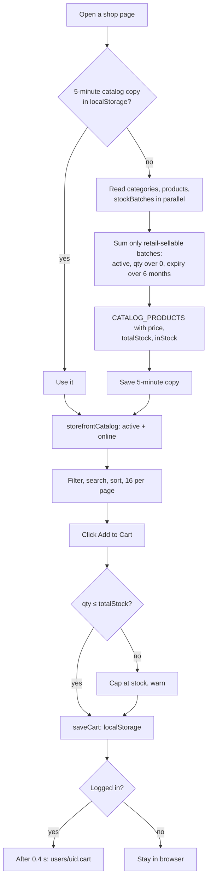

# 03 - Shop and Cart

**Files:** `shop/index.html` (home), `shop/products.html` + `js/products.js`, `shop/product-details.html` + `js/product-details.js`,
`shop/cart.html` + `js/cart-page.js`, `js/cart.js` (cart engine, on every shop page), `js/shop-header.js` (search, bell),
`js/shop-sections.js`, and the storefront parts of `js/products-data.js` (catalog loading, product cards, quick view).

---

## 1. What it does and why Amson needs it

- Customers can **browse** Amson's medicines and supplies 24/7, **search** by name, generic name or brand, **filter** by category, section, price and stock, and **sort**.
- The shop shows **real, current stock**: only batches that are sellable in retail are counted. This matters for a pharmacy: we must never sell expired medicine or medicine close to expiry online.
- The **cart** remembers items for guests (in the browser) and for logged-in customers (saved to their account, so it follows them to another device).
- Customers can tick which cart items to check out now; unticked items stay for later.

---

## 2. Walkthrough

### 2.1 Loading the catalog: `loadCatalogCache()` (`js/products-data.js:1001-1061`)

Every shop page calls this first. It builds `CATALOG_PRODUCTS`, the list every page works from.

```js
const cached = readCatalogBrowserCache();
if (cached) { CATEGORY_LABELS = cached.categories || {}; CATALOG_PRODUCTS = cached.products; return ...; }
```
1. **Shop pages reuse a 5-minute copy** saved in localStorage (`CATALOG_CACHE_MS = 5 * 60 * 1000`, line 893). This cuts database reads, which matters on the free plan's daily limits. Staff pages never use this copy (`catalogBrowserCacheAllowed`, line 895), so staff always see live stock.

```js
await authGate;
const [categorySnapshot, productSnapshot, allBatchSnapshot, privatePrices] = await Promise.all([...]);
```
2. Read categories, products and stock batches **at the same time** (`Promise.all`), not one after another.
   The first load uses **live listeners** (`liveQuery`, line 799), so later changes arrive automatically.

```js
batchSnapshot.docs.forEach((doc) => {
  const batch = doc.data();
  if (!isRetailSellableBatch(batch)) return;
  stockByProduct[batch.productId] = (stockByProduct[batch.productId] || 0) + (batch.quantity || 0);
});
```
3. Add up stock per product, counting **only retail-sellable batches**:
   ```js
   // products-data.js:256-258
   function isRetailSellableBatch(batch) {
     return batch.status === "active" && (batch.quantity || 0) > 0 && new Date(batch.expirationDate) > nearExpiryCutoff();
   }
   ```
   A batch counts only if it's `active`, has units, and expires **more than 6 months** from today (`NEAR_EXPIRY_MONTHS = 6`, line 247).

```js
CATALOG_PRODUCTS = productSnapshot.docs.map((doc) => {
  const data = doc.data();
  const totalStock = stockByProduct[doc.id] || 0;
  return { id: doc.id, ...data, ...(privatePrices.get(doc.id) || {}),
           shopSection: resolveShopSection(data.shopSection), price: data.retailPrice,
           totalStock, inStock: data.status === "active" && totalStock > 0 };
});
```
4. Each product gets `price` (the retail price), `totalStock` and `inStock`. On staff pages only, the private
   cost and wholesale prices are merged in from `productPrices` (customers can't read that collection).

### 2.2 What the shop shows: `storefrontCatalog()` (`products-data.js:208-210`)

```js
return CATALOG_PRODUCTS.filter((p) => p.status === "active" && p.availableInOnlineStore);
```
Only **active** products marked **available online** appear in the shop. (The POS uses `availableInPOS` instead.)

### 2.3 The products page (`js/products.js`)

- `init()` (`products.js:148-179`): waits for the catalog, builds the category tick boxes from the `categories` collection, reads `?q=` (search), `?category=` and `?section=` from the address bar, then calls `applyFilters()`.
- `matchesSearch` (`products.js:26-33`): every typed word must appear somewhere in the name, generic name, brand or description, ignoring capitals. "bio 500" matches "Biogesic 500mg".
- `applyFilters` (`products.js:62-98`): filters by category, section, min/max price and stock, then sorts. **Out-of-stock products always go to the bottom** (`products.js:81`).
- `renderPage` (`products.js:100-117`): shows 16 per page (`PAGE_SIZE`) with page buttons.
- Each product card comes from `renderProductCard` (`products-data.js:2441-2470`). Every text value is wrapped in `escapeHtml`, and out-of-stock items get a disabled button.

### 2.4 Add to Cart (`js/cart.js`)

One listener for the whole page (`cart.js:235-246`) catches clicks on any `.btn-add-cart`:

```js
function addToCart(productId, qty = 1) {              // cart.js:111
  const cart = getCart();
  const existing = cart.find((item) => item.id === productId);
  const product = getProductById(productId);
  const maxQty = product ? product.totalStock : Infinity;
  const desiredQty = (existing ? existing.qty : 0) + qty;
  const finalQty = Math.min(desiredQty, maxQty);       // never more than in stock
  const capped = finalQty < desiredQty;
  if (finalQty <= 0) return { qty: currentQty, capped: true };   // out of stock
  if (existing) existing.qty = finalQty; else cart.push({ id: productId, qty: finalQty });
  saveCart(cart);
  return { qty: finalQty, capped };
}
```
- The cart is a list of `{ id, qty }`. **Prices are not stored in the cart**; they're always read fresh from the catalog, so a stale price can't sneak in.
- `capped` tells the caller to show "Only N in stock - your cart is now at the limit."
- "Buy Now" (`cart.js:250-259`) adds the item, waits up to 2 seconds for the account copy to save, then opens the cart.

### 2.5 Where the cart is saved: `saveCart()` and syncing (`cart.js:32-108`)

- **Guests:** localStorage key `amsonCart`.
- **Logged-in customers:** localStorage key `amsonCart:<uid>` **and** the `cart` field on their `users` doc (written 0.4 s after the last change, `flushCartSync`). The rules allow this because it's their own doc.
- On login (`cart.js:74-108`), the guest cart is **merged** into the account cart (taking the bigger quantity of each item), and whichever copy is newer wins. So nothing added before logging in is lost.
- When a page is closed (`pagehide`), any pending save is flushed.

### 2.6 The cart page (`js/cart-page.js`)

- `renderCartPage` (`cart-page.js:52-70`): one row per item, with − / + buttons, a quantity box and "Remove". "N available" shows under each item.
- **Select items for checkout:** every item starts ticked. `selectedIds` holds the ticked ones; the total shows only those (`updateSelectionSummary`, `cart-page.js:170-187`).
- **Typed quantity** (`cart-page.js:150-161`): `wholeQty()` accepts only whole numbers of 1 or more. "1.5", "-3" or "abc" put the old quantity back with a message.
- **Proceed to Checkout** (`cart-page.js:205-210`) saves the ticked ids to `sessionStorage` (`amsonCheckoutSelectedIds`) and opens `checkout.html`.
- "You might also like" suggestions prefer products from the same categories as the cart (`renderCartSuggestions`, `cart-page.js:38-50`).

---

## 3. Flowchart



---

## 4. Design decisions

| Decision | Why | Alternatives we didn't use |
| --- | --- | --- |
| Load the whole catalog once and filter in the browser | One branch has a few hundred products; filtering in the browser is instant and costs no extra reads. | A database query per filter (more reads, slower, needs indexes). |
| 5-minute browser copy for shop pages only | Saves Firestore reads on the free plan; 5 minutes is short enough to stay accurate. Payment re-checks stock live anyway. | No cache (more reads); a long cache (stale stock). |
| Stock computed from batches, not a single "stock" number on the product | One source of truth. Expiry rules (6-month retail cut-off) are applied automatically, and FEFO needs per-batch quantities. | A `stock` field on each product (easy to get out of sync with batches). |
| Cart holds only `{id, qty}` | Prices can't go stale in the cart; they're read fresh from the catalog. | Storing price in the cart (could charge an old price). |
| Cart in localStorage + account | Guests can shop without signing up; logged-in carts follow the customer to other devices. | Account-only cart (forces login to shop), or browser-only (lost on another device). |
| Out-of-stock items stay visible but at the bottom | Customers can still see we carry it; staff sometimes restock soon. | Hiding them (customers think we don't carry it). |

---

## 5. What happens if…

1. **…a customer adds more than the stock?** `addToCart` caps the quantity at `totalStock` and shows "Only N in stock". The + button is disabled at the limit (`cart-page.js:106`).
2. **…stock runs out while it's in someone's cart?** The cart still shows it, but the payment page re-reads stock live and refuses: "Some items in your cart exceed what's currently in stock…" (see `04-checkout-and-qr-payment.md`).
3. **…a batch reaches 6 months before expiry?** `isRetailSellableBatch` stops counting it, so the shop's stock drops (or shows Out of Stock). The units can still go to wholesale.
4. **…staff mark a product inactive or untick "available online"?** It disappears from `storefrontCatalog()`. Within 5 minutes for customers with a cached copy; immediately on the payment re-check.
5. **…someone searches with HTML like `<b>hi</b>`?** The search text is shown with `escapeHtml` (`products.js:110`, `:159`), so it's displayed as text.
6. **…a customer types "2.5" as a quantity?** `wholeQty` gives `NaN` → the old quantity comes back with "Please enter a whole number of 1 or more."
7. **…the internet is off when the page opens?** If there's a fresh 5-minute copy, the shop still shows it. Otherwise the live listener waits up to 10 seconds (`LIVE_QUERY_OFFLINE_MS`, line 192) and then tries a direct read.
8. **…someone edits the price in their cart from the console?** The cart has no prices, and the order total is recalculated from the catalog at payment. A tampered order would still be flagged at staff verification (see module 05).
9. **…a guest adds items and then logs in?** The guest cart is merged into the account cart, and the guest copy is cleared (`cart.js:100-102`).
10. **…localStorage is blocked (private mode)?** Every storage call is in `try/catch`; logged-in carts still save to the account.
11. **…two tabs change the cart?** Both write to the same localStorage key; the newest save wins. On reload the newer copy (by `cartUpdatedAt`) is used.

---

## 6. Security rules for this module

| Rule (`firestore.rules`) | What it does |
| --- | --- |
| `products` read: `if true` (87) | Anyone, even guests, can browse. Write needs staff (89-102). |
| `productPrices` read: `isStaff()` (107) | Cost and wholesale prices are **not visible** to customers or guests, only retail. |
| `stockBatches` read: `if true` (215) | The shop needs real quantities. Write needs staff. |
| `categories` read: `if true` (121) | Category names are public. |
| `users` update own doc (51-55) | Lets a customer save their own `cart`, but not change role, status or raise credit. |

---

## 7. Known limitations and how we'd improve them

1. **Stock records are public, including some back-office fields** (supplier id, receipt number, disposal note). **Improve:** move those fields to a staff-only collection, as was already done for costs (`batchCosts`).
2. **The shop copy can be up to 5 minutes old.** Fine for browsing, and payment re-checks live. **Improve:** shorter cache or live listeners on the products page.
3. **Stock isn't reserved when items are in a cart** (or even when an order is placed); it's deducted when staff approve the payment. Two customers can order the last unit; the second goes to an out-of-stock hold. **Improve:** reservation with a timeout (needs server logic).
4. **Search is simple word matching**, no typo tolerance in the shop. **Improve:** a search service, or a "did you mean" list.
5. **Loading all products at once** won't scale to tens of thousands of items. **Improve:** paginated queries.

---

## 8. Likely panel questions

1. **"How do you make sure expired medicine isn't sold online?"** Shop stock only counts batches that are active and expire more than 6 months from today (`isRetailSellableBatch`, `products-data.js:256`). Near-expiry batches move to "wholesale only" and expired ones to Bad Order (module 08).
2. **"Where does the shop's stock number come from?"** It's the sum of retail-sellable `stockBatches` for that product, computed in `loadCatalogCache` (`products-data.js:1031-1036`).
3. **"Why isn't there a stock field on the product?"** Stock lives on batches because each batch has its own expiry. One number on the product would get out of sync and can't do FEFO.
4. **"Can customers see your cost price?"** No. Cost and wholesale prices are in `productPrices`, readable only by staff (`firestore.rules:106-111`). Product docs only hold the retail price.
5. **"Why cache the catalog?"** Firestore's free plan has daily read limits. A 5-minute copy cuts reads a lot; payment always re-checks live.
6. **"What if the price changes while the item is in my cart?"** The cart doesn't store prices. The payment page recomputes the total and, if it changed, shows the new total and asks you to submit again (`payment.js:265-272`).
7. **"How does the cart follow me to another device?"** Logged-in carts are saved to `users/{uid}.cart` (`flushCartSync`, `cart.js:49`). On login they're loaded and merged.
8. **"How is the search done?"** In the browser: every typed word must appear in the name, generic name, brand or description (`matchesSearch`, `products.js:26`).
9. **"What stops XSS on product cards?"** All text goes through `escapeHtml` before being put into the HTML (`renderProductCard`, `products-data.js:2441`).
10. **"Why are out-of-stock items shown?"** So customers know we carry them. They're sorted last and their buttons are disabled.
11. **"What's the difference between `availableInOnlineStore` and `status`?"** `status: "inactive"` hides a product everywhere. `availableInOnlineStore` only controls the shop; a product can be POS-only.
