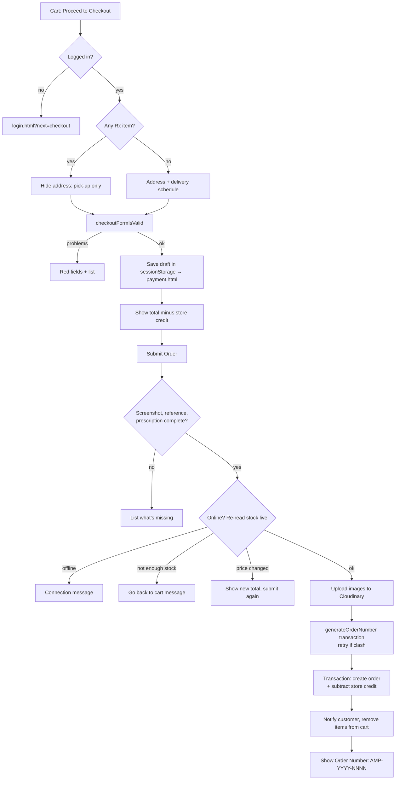

# 04 - Checkout and QR Ph Payment

**Files:** `shop/checkout.html` + `js/checkout.js`, `shop/payment.html` + `js/payment.js`, `js/orders.js`
(`generateOrderNumber`, `createOrderWithCreditRedemption`, `notifyCustomer`), `js/cloudinary.js`, `js/validators.js`,
`assets/payment-qr.*` (the QR image), `firestore.rules` (orders, counters, customerNotifications).

---

## 1. What it does and why Amson needs it

- The customer enters **contact details and a delivery address**, then pays by scanning Amson's **QR Ph code**
  (GCash, Maya or any bank app) and uploads a **screenshot** with the **reference number**.
- Amson is a small branch with no card terminal online and no payment gateway contract. QR Ph is free,
  familiar to Filipino customers, and money goes straight to the branch's account. Staff verify the payment by hand (module 05).
- **Prescription (Rx) items** are **pick-up only**. The customer uploads a prescription photo, and the pharmacist checks the original at pick-up. This follows pharmacy rules: Rx medicine can't simply be delivered on request.
- **Store credit** (from overpayments or closed orders) is applied automatically, because Amson's policy is
  **no cash refunds**: money already paid stays as credit.
- Non-Rx orders are delivered by **Lalamove**; the rider's fee is paid separately to the rider.

---

## 2. Walkthrough

### 2.1 Checkout page (`js/checkout.js`)

1. **Which items?** `getCheckoutCart()` (`checkout.js:33-45`) takes the cart and keeps only the ids ticked on the cart page (`amsonCheckoutSelectedIds`). Nothing ticked → the whole cart.
2. **Must be logged in.** `auth.onAuthStateChanged` (`checkout.js:190-213`): no user → `login.html?next=shop%2Fcheckout.html`. Logged in → fill in name, email, phone and the **saved address**.
3. **Prescription check** (`checkout.js:58-69`):
   ```js
   requiresPrescription = cart.some((item) => { const product = getProductById(item.id); return product && product.rxRequired; });
   if (requiresPrescription) {
     pickupNoticeCard.classList.remove("d-none");
     shippingAddressSection.classList.add("d-none");
     ...
   }
   ```
   If any item needs a prescription, the address section is hidden and a "pick-up at the store" notice shows.
4. **Delivery schedule** (`checkout.js:76-102`): "Same Day" or a date + time slot. Dates in the past are blocked (`deliveryDateInput.min = todayISO`, using the **local** date so it isn't "yesterday" before 8 AM, which is midnight UTC).
5. **Form check** (`checkoutFormIsValid`, `checkout.js:108-136`): every problem gets a red outline and one line in a list above the button. Patterns come from `validators.js`, the same ones the register page uses. The address uses `addressProblems()` (`validators.js:70`): street 5-150 characters with no `<` `>`, city/province 2-60, ZIP exactly 4 digits.
6. **Proceed to Payment** (`checkout.js:144-186`): saves the order draft to `sessionStorage.amsonPendingOrder` and the address to the user's profile, then opens `payment.html`. **Nothing is ordered yet.**

### 2.2 Payment page (`js/payment.js`)

1. **Summary and credit preview** (`showOrderSummary`, `renderCreditPreview`, `payment.js:46-116`):
   ```js
   const applied = Math.max(0, Math.min(customerCreditBalance, cartSubtotal));
   const finalTotal = cartSubtotal - applied;
   fullyCoveredByCredit = finalTotal <= 0 && cartSubtotal > 0;
   ```
   Uses as much credit as possible but never more than the total. If credit covers everything, the QR box hides and no screenshot is needed.
2. **Upload boxes** (`setUpFilePicker`, `payment.js:155-179`): a preview of the picked image; files over **10 MB** are refused (`MAX_PROOF_FILE_SIZE_BYTES`, line 3).
3. **Submit Order** runs `submitOrder()` (`payment.js:182-198`) in three stages:

**Stage A, is the form complete?** `checkPaymentForm` (`payment.js:210-232`):
- prescription photo needed for Rx orders;
- screenshot needed unless credit covers it;
- the reference number must pass `isValidReferenceNumber` (`validators.js:88`): up to 40 characters, at least 4 letters or digits, only letters, digits, spaces and `- . # :`.

**Stage B, are stock and prices still OK?** `stockAndPricesStillOk` (`payment.js:235-285`):
```js
if (navigator.onLine === false) return connectionProblem();
clearCatalogCache();
try { await loadCatalogCache(); } catch (error) { return connectionProblem(); }
```
- Offline → "We couldn't reach the store to check stock. Check your internet connection…"
- Throws away the 5-minute copy and **re-reads stock live**.
- Any item over the live stock (or no longer sold online) → "Some items in your cart exceed what's currently in stock: … Please go back to your cart."
- Total changed since the page opened (a price change) → shows the new total and asks the customer to tap Submit again.

**Stage C, place the order.** `placeOrder` (`payment.js:288-358`):
```js
const proofOfPaymentUrl = file ? await uploadToCloudinary(file) : null;
const prescriptionPhotoUrl = prescriptionFile ? await uploadToCloudinary(prescriptionFile, { kind: "document" }) : null;
const orderNumber = await generateOrderNumber();
const items = pendingOrder.cart.map((item) => { const product = getProductById(item.id);
  return { id: item.id, name: product.name, price: product.price, qty: item.qty, imageUrl: product.imageUrl || null }; });
await createOrderWithCreditRedemption({ orderNumber, customerId: user.uid, contact, shipping, deliverySchedule,
  items, total: cartSubtotal, proofOfPaymentUrl, paymentReferenceNumber: referenceNumber || null,
  requiresPrescription, prescriptionPhotoUrl, status: "placed",
  statusTimestamps: { placed: serverTimestamp(), payment_confirmed: null, dispatched: null, delivered: null, received: null },
  createdAt: serverTimestamp() }, { expectFullCredit: fullyCoveredByCredit });
```
- Images go to **Cloudinary** first (`uploadToCloudinary`, `cloudinary.js:37`). Big phone photos are shrunk to a JPEG first (`shrinkImageForUpload`, `cloudinary.js:12`). We save only the returned `https://res.cloudinary.com/...` link.
- `generateOrderNumber` (`orders.js:313-338`) gives `AMP-2026-0001`, `AMP-2026-0002`… using a **transaction** on `counters/orders-2026`. If two customers submit at the exact same moment, the rules refuse the second one's stale number with `permission-denied`, so the code **retries up to 3 more times** after a short random wait:
  ```js
  if (error && error.code === "permission-denied" && attempt < 4) {
    await new Promise((resolve) => setTimeout(resolve, 150 * attempt + Math.random() * 200));
    continue;
  }
  ```
- The price on each item is taken **from the catalog just re-read**, not from anything the customer typed.

**Store credit, all-or-nothing:** `createOrderWithCreditRedemption` (`orders.js:280-311`):
```js
const { appliedCredit, finalTotal } = await db.runTransaction(async (transaction) => {
  const userDoc = await transaction.get(userRef);
  balance = userDoc.exists ? userDoc.data().creditBalance || 0 : 0;
  const appliedCredit = Math.max(0, Math.min(balance, orderData.total));
  const finalTotal = orderData.total - appliedCredit;
  if (expectFullCredit && finalTotal > 0) throw new Error("Your store credit balance changed...");
  transaction.set(orderRef, { ...orderData, subtotal: orderData.total, total: finalTotal, creditApplied });
  if (appliedCredit > 0) transaction.update(userRef, {
    creditBalance: firebase.firestore.FieldValue.increment(-appliedCredit), lastCreditOrderId: orderRef.id });
});
```
- Reads the **current** balance inside the transaction, so credit can't be spent twice.
- The order and the credit deduction save **together**. The rules check that the balance after the write is exactly the old balance minus `creditApplied`, and that `lastCreditOrderId` is this order (`firestore.rules:143-147`).

**After saving** (`payment.js:329-352`): the customer gets an "Order placed" bell notice (and email), the ordered items leave the cart (unticked ones stay), the draft is cleared, and the confirmation with the order number shows.

> **Important:** placing an order does **not** take stock off. Stock is deducted when staff **approve the payment** (module 05), in the same transaction that gives the SI number. Unverified orders never reduce stock.

---

## 3. Flowchart



---

## 4. Design decisions

| Decision | Why | Alternatives we didn't use |
| --- | --- | --- |
| QR Ph + screenshot + manual verification | No gateway fees or contract, customers already use GCash/Maya, money goes directly to the branch. | PayMongo / PayPal gateway: fees, business documents and a server for webhooks. Cash on delivery: risky for a pharmacy. |
| Rx orders are pick-up only | Pharmacy rules: the pharmacist must see the original prescription and a valid ID. | Delivering Rx items (not allowed without checking the original). |
| Deduct stock on staff approval, not at order time | Unpaid or fake orders would otherwise lock up stock. | Reserve stock at order time (needs automatic release of abandoned orders, which needs a server). |
| Re-check stock and prices live before submitting | The shop copy can be up to 5 minutes old. | Trusting the cached copy. |
| Order numbers from a transaction-protected counter, with retry | Unique, readable numbers (AMP-2026-0001) even with simultaneous checkouts. | Random ids only (hard for customers and staff to read out). |
| Credit applied inside the same transaction as the order | Can't spend the same credit twice; can't create the order without deducting credit. | Two separate writes (a crash in between would give free credit). |
| Images on Cloudinary, only the link in Firestore | Firestore documents are limited to 1 MB; Cloudinary is free and resizes. | Firebase Storage (needs Blaze for our setup); base64 inside Firestore (too big). |
| Draft kept in sessionStorage between checkout and payment | Nothing is written to the database until the customer actually submits. | Saving a "draft order" document (more writes, leftovers to clean up). |

---

## 5. What happens if…

1. **…the internet drops before Submit?** `navigator.onLine === false` → "We couldn't reach the store to check stock. Check your internet connection, then tap Submit Order again." Nothing is saved.
2. **…the internet drops after the images upload but before the order saves?** The order transaction fails → the error shows above the button and Submit becomes clickable again. The images stay on Cloudinary unused; no order or credit change was made (all-or-nothing).
3. **…the customer double-clicks Submit?** The button is disabled on the first click (`payment.js:192`), so only one order is made (this was tested).
4. **…two customers submit at the same moment?** Both order-number transactions run. The rules refuse the late one's stale number; `generateOrderNumber` waits a moment and retries, so both get **different** numbers (tested: 10 of 10 placed).
5. **…someone buys the last unit while I'm on the payment page?** The live re-check catches it: "Some items in your cart exceed what's currently in stock… (only 0 left, 1 in your cart)."
6. **…a price changes while I'm paying?** "Some prices changed since you opened this page. Your new total is ₱X. Please check it and tap Submit Order again."
7. **…a customer edits the order from the console to set prices to ₱1?** The rules can't check every price, so it would save. But staff see a red warning in verification ("… is ₱1 on this order but ₱100 in the catalog") and must confirm "Approve anyway" (module 05). Staff also check the amount actually received in the GCash/bank app.
8. **…someone tries to create an order for another customer, or as already "payment_confirmed"?** Refused by the rules: `customerId` must be your own uid and `status` must be `"placed"` (`firestore.rules:136-138`).
9. **…someone saves a proof link from another website?** Refused: photo links must start with `https://res.cloudinary.com/wb6wxped/` (`photoLinkOk`, `firestore.rules:126-129`).
10. **…someone tries to use more store credit than they have?** The transaction uses the real balance. A hand-made write that doesn't subtract the credit, or subtracts the wrong amount, is refused by the rules (143-147).
11. **…the screenshot is 15 MB?** "That file is too large. Please upload an image under 10MB." (browser check).
12. **…the reference number is "ab"?** Refused: needs at least 4 letters or numbers.
13. **…credit covered everything when the page opened, but the balance dropped (used on another order)?** `expectFullCredit` is true and the new total is above 0 → "Your store credit balance changed, so it no longer covers this order. Please reload the page to pay the rest."
14. **…a guest opens payment.html directly?** Redirected to login; with no draft it shows "No pending order".

---

## 6. Security rules for this module

| Rule (`firestore.rules`) | What it blocks |
| --- | --- |
| `orders` create: signed in, `customerId == myUid()` (136-137) | Placing orders as someone else. |
| `status == "placed"` (138) | Creating an order that's already "paid" or "dispatched". |
| `total >= 0` (139) | Negative totals. |
| no `paymentIssue`, `invoiceNo`, `unappliedCredit`, `paymentOverage`, `verification`, `closedReason` (140) | Customers writing staff-only fields (fake SI number, fake verification). |
| `photoLinkOk` for proof and prescription (141-142) | Proof images hosted somewhere else. |
| credit: `getAfter(...)creditBalance == get(...)creditBalance - creditApplied` and `lastCreditOrderId == orderId` (143-147) | Using credit without it coming off the balance. |
| `counters` `orders-YYYY` create = 1, update = +1 only (318-321) | Resetting or jumping order numbers. |
| `customerNotifications` customer create only `order_placed` with fixed fields (198-202) | Customers writing fake notices to themselves with other kinds. |
| `users` own update: credit can't go up (54) | Giving yourself store credit. |

---

## 7. Known limitations and how we'd improve them

1. **Prices and totals come from the browser.** Staff are warned about mismatches, but the database doesn't reject them. **Improve:** a rule that compares each item's price to the product (works for a small number of items), or a Cloud Function that builds the order on the server.
2. **The same screenshot or reference number could be reused.** Staff now get a warning ("This reference number was already used on order AMP-…"), but only staff checking the bank app can truly confirm payment. **Improve:** a register of used reference numbers that the database refuses to repeat.
3. **Cloudinary uploads are unsigned**, so the upload settings are public, and the 10 MB limit is browser-only. **Improve:** limit formats/size/folder in the Cloudinary preset, or sign uploads on a server.
4. **Stock isn't reserved at order time**, so two customers can order the last unit. The second goes to an out-of-stock hold, which works as designed but disappoints the customer.
5. **Unused images** stay on Cloudinary if a submit fails after uploading.
6. **No automatic payment confirmation.** It depends on staff checking their GCash/bank app.

---

## 8. Likely panel questions

1. **"Why QR Ph instead of a payment gateway?"** No fees or contracts, customers already use it, money goes straight to the branch. The trade-off is manual verification, which we support with the verification queue, price warnings and reused-reference warnings.
2. **"When is stock deducted for online orders?"** When staff approve the payment, not when the order is placed. Approval runs `deductStockFEFOMultiple` in one transaction with the SI number (`confirmOrderSale`, `admin-online-orders.js:656`).
3. **"How do you prevent duplicate order numbers?"** A Firestore transaction on `counters/orders-YYYY`, a rule that only allows +1, and a retry when two checkouts clash (`generateOrderNumber`, `orders.js:313`).
4. **"What if the customer changes the prices in the browser?"** The order still saves, but staff see a price-mismatch warning and must confirm "Approve anyway" (`confirmPriceProblems`, `admin-online-orders.js:554`). Staff also check the actual amount received. Moving pricing to the server is our planned improvement.
5. **"How does store credit work, and can it be abused?"** Credit comes from overpayments and closed holds. At checkout it's subtracted inside the same transaction that creates the order (`createOrderWithCreditRedemption`, `orders.js:280`), and the rules check the balance went down by exactly the amount used.
6. **"Why are prescription orders pick-up only?"** The pharmacist must check the original prescription and a valid ID before releasing Rx medicine.
7. **"Where are the payment screenshots stored?"** On Cloudinary. Firestore only stores the link, and the rules only accept links to our own Cloudinary account.
8. **"What happens if I lose internet in the middle of submitting?"** Either the order fully saves or nothing does (transaction). You get a message and can tap Submit again.
9. **"Why check the stock again on the payment page?"** The shop uses a copy up to 5 minutes old; we re-read live right before submitting so customers don't pay for items that just sold out.
10. **"Why does the date picker use local time?"** Philippine time is UTC+8. Before 8 AM, UTC is still "yesterday", so `toISOString()` would allow yesterday's date. `localISODate()` (`products-data.js:1262`) uses the local calendar.
11. **"How big can an upload be?"** Under 10 MB; phone photos over 300 KB are shrunk to JPEG first (`cloudinary.js:12`), which saves data for customers.
