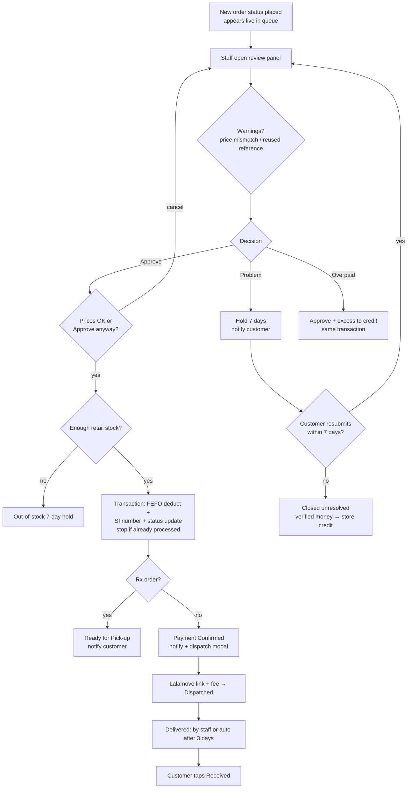

# 05 - Online Order Verification

**Files:** `admin/online-orders.html` + `js/admin-online-orders.js` (staff side), `shop/orders.html` + `js/orders-list.js`,
`shop/order-details.html` + `js/order-details.js` (customer side), `js/orders.js` (statuses, holds, deadlines, credit,
notifications, emails), `js/products-data.js` (`deductStockFEFOMultiple`, `logAuditEvent`), `firestore.rules` (orders).

---

## 1. What it does and why Amson needs it

Because payment is a **QR Ph screenshot**, a person must confirm the money really arrived before the medicine leaves the store.
This page is that person's workbench:

- a **Payment Verification queue** of new orders (oldest first), with the screenshot, reference number, items and total side by side;
- **Approve** → deducts stock (FEFO), gives an **SI number**, tells the customer, then asks for the **Lalamove** tracking link and fee;
- **Problems** → a **7-day hold**:
  - invalid payment, payment not received or underpayment: the customer must re-upload or top up;
  - overpayment: approved, and the extra becomes store credit;
  - prescription rejected: the customer uploads a new prescription;
  - out of stock: waits for a restock;
- holds not fixed in 7 days close automatically, and any money already verified becomes **store credit** (Amson policy: **no refunds**);
- the **order status steps**: Placed → Payment Confirmed → Dispatched → Delivered → Received. Rx orders: Placed → Payment Confirmed → **Ready for Pick-up** → Picked Up.

Every step is written to the **audit log** and the customer gets a **bell notice + email**.

---

## 2. Walkthrough

### 2.1 Loading and live updates (`admin-online-orders.js:200-269`)

```js
document.addEventListener("admin:ready", loadOrders);
...
unsubscribeOrders = db.collection("orders").onSnapshot((snap) => {
  const fresh = snap.docs.map((doc) => ({ id: doc.id, ...doc.data({ serverTimestamps: "estimate" }) }));
  if (first) { first = false; resolve(fresh); return; }
  clearTimeout(ordersRefreshTimer);
  ordersRefreshTimer = setTimeout(() => { allOrders = fresh; renderVerificationQueue(); renderOrdersTable(); }, 300);
}, ...);
```
- The page **listens** to all orders, so a new order appears **without refreshing**. The 300 ms timer groups several quick changes into one redraw.
- On load, `enforceOrderDeadline(..., { grantCreditToBalance: true })` runs for every order (`loadOrders`, line 211-213), closing expired holds (see 2.6).

### 2.2 The queue (`verificationQueue`, lines 432-453)

```js
let queue = allOrders.filter((order) => order.status === "placed" && (!order.paymentIssue || order.paymentIssue.resolvedByCustomerAt));
```
"Placed orders with no open hold, plus held orders the customer has resubmitted." It can be filtered (Rx / regular), searched (order no., reference, SI no., name) and sorted.

### 2.3 The review panel (`renderReviewPanel`, lines 563-653)

It shows items, total (with credit used), reference number, the payment screenshot and the prescription photo.
Two automatic warnings appear:

- **Price check**: `orderPriceProblems` (lines 506-519) compares each item's price with the catalog, and the item sum with the total:
  ```js
  else if (Math.abs((item.price || 0) - (product.price || 0)) > 0.001)
    problems.push(`${product.name} is ${formatPeso(item.price)} on this order but ${formatPeso(product.price)} in the catalog`);
  ```
- **Reused reference**: `warnIfReferenceReused` (lines 522-551) searches `orders` and `posSales` for the same reference number, with and without spaces/dashes:
  "This reference number was already used on order AMP-… Check in the GCash / bank app that this is a new payment before approving."

### 2.4 Approve (`approvePaymentBtn` click, lines 736-796)

```js
if (!(await confirmPriceProblems(order))) return;          // 1. bad prices need "Approve anyway"
const stockCheck = await warnIfOrderCantBeFulfilled(order); // 2. enough stock?
if (stockCheck === "cancel") return;
if (stockCheck === "hold") throw new Error("Not enough stock available to fulfill this quantity.");
const newStatus = order.requiresPrescription ? "delivered" : "payment_confirmed";   // 3. Rx goes straight to Ready for Pick-up
const { invoiceNo, itemsWithBatches } = await confirmOrderSale(order, (allocations, invoiceNo, itemsWithBatches) => ({
  status: newStatus, invoiceNo, items: itemsWithBatches,
  "statusTimestamps.payment_confirmed": serverTimestamp(),
  paymentIssue: FieldValue.delete(),
  verification: verificationStamp("payment_approved"),
}));
notifyOrderApproved(order);                                 // 4. bell + email + audit log
```

1. `confirmPriceProblems` (554-561): when prices don't match, a dialog says "Only approve if the payment received covers the correct amount" with **Approve anyway / Cancel**.
2. `warnIfOrderCantBeFulfilled` (702-718) reads the retail-sellable stock. If it's short, staff choose **"Put on 7-day hold"** or Cancel.
3. `confirmOrderSale` (656-681) calls the shared FEFO engine:
   ```js
   await deductStockFEFOMultiple(lineItems.map((item) => ({ productId: item.id, qty: item.qty })), {
     record: { ref: db.collection("orders").doc(order.id), mode: "update", build: ...,
       check: (doc) => {
         const fresh = doc.exists ? doc.data() : null;
         if (!fresh || fresh.status !== "placed" || fresh.invoiceNo)
           throw new Error("This order was already processed by someone else. Refresh the page to see its current status.");
       } } });
   ```
   In **one transaction** it:
   - re-reads the batches and takes stock oldest-expiry-first;
   - re-reads the order and **stops if another staff member already approved it** (`check`);
   - gives the next **SI number** from `counters/salesInvoices`;
   - saves the order as Payment Confirmed with the batches used on each item.
   It all saves together or not at all (details in `07-inventory-and-fefo.md`).
4. `verificationStamp` (58-65) records **who** approved and **when** (server time) in `order.verification`.
5. `notifyOrderApproved` (68-92): "Payment confirmed for order AMP-…" (or "ready for pick-up" for Rx), plus an audit log entry listing the SI number and the stock deducted.

### 2.5 Payment issues and holds (lines 884-1138)

Staff pick an issue type from the dropdown, which opens a modal (`openPaymentIssueModal`, 905-949):

| Type | Mode | What happens |
| --- | --- | --- |
| Invalid payment | hold | Reason (unclear/incomplete screenshot, etc.) + note → customer must re-upload |
| Payment not received | hold | Customer must upload proof of a completed transaction |
| Underpayment | hold | Staff type the amount received; must be **less than** the total. Shows the outstanding balance. |
| Overpayment | **approve** | Amount received must be **more than** the total. Approved like normal; the excess is added to the customer's `creditBalance` **in the same transaction** (`approveOverpaidOrder`, 1018-1082). |
| Prescription rejected | hold | Its own button (`rejectPrescriptionBtn`, 802-876): reason + message; optional "payment was checked and received in full" (then the payment becomes credit if the order later closes). |
| Out of stock | hold | Automatic when approval finds too little stock (`holdOrderForOutOfStock`, 721-734). The customer isn't notified about this one; staff wait for a restock. |

A hold is saved as `order.paymentIssue = { type, note, flaggedAt, holdUntil: now + 7 days, ... }` (`placeOrderOnPaymentHold`, 969-1015), with an audit entry and a "Payment issue on order …" notice to the customer.

### 2.6 The customer fixes it (`js/order-details.js:186-198`)

```js
const uploadedUrl = await uploadToCloudinary(file, { kind: rxIssue ? "document" : "payment" });
const update = { "paymentIssue.resolvedByCustomerAt": serverTimestamp(), "paymentIssue.holdUntil": FieldValue.delete() };
if (rxIssue) update.prescriptionPhotoUrl = uploadedUrl;
else { update.proofOfPaymentUrl = uploadedUrl; update.paymentReferenceNumber = referenceNumber; }
await currentOrderRef.update(update);
```
The order goes back into the staff queue with a **"Customer Resubmitted"** badge. The customer's order page listens live (`onSnapshot`, `order-details.js:308`), so a staff hold appears there without refreshing.

### 2.7 Deadlines (`enforceOrderDeadline`, `js/orders.js:175-267`)

Runs whenever an order is loaded:
- **Hold past `holdUntil`** → in a transaction: status `closed_unresolved`, `paymentIssue` removed, and `computeUnappliedCredit()` (`orders.js:49-59`) decides how much becomes credit:
  - **underpayment**: the amount received;
  - **out of stock**: the full total;
  - **rejected prescription**: the total, only if staff ticked "payment received";
  - **invalid payment**: only credit that was already used on the order.
  The credit is added with `FieldValue.increment(...)` in the same transaction. Only **staff pages** do this (`grantCreditToBalance: true`); customer pages just *display* it as closed.
- **Dispatched more than 3 days ago** → marked Delivered automatically (`DISPATCH_AUTO_DELIVER_MS`, line 93), logged as "Order Auto-Delivered" by System.

### 2.8 Dispatch and the rest of the steps

- **Mark Dispatched** (`markDispatchedBtn`, 1225-1284): the tracking link must look like `https://share.lalamove.com/...` (`LALAMOVE_TRACKING_LINK_REGEX`, line 175), and the Lalamove fee must be 0 or more. Saves `status: "dispatched"`, the link and fee, and notifies the customer with the tracking link.
- **Advance status** (`advanceOrderStatus`, 1542-1587): only **one step forward** at a time (`expectedNext = steps[steps.indexOf(previousStatus) + 1]`), always with a confirm box. Staff can't mark a delivery order "Received"; only the customer can (or the 3-day auto rule makes it Delivered).
- **Customer confirms receipt** (`order-details.js:368-385`): Delivered → Received. The rules allow exactly this change and nothing else.
- **Release hold** (`releaseOrderHold`, 1589-1614): staff can clear a hold so the order returns to normal review, for example after the customer paid the balance at the store.

---

## 3. Flowchart



---

## 4. Design decisions

| Decision | Why | Alternatives we didn't use |
| --- | --- | --- |
| Manual verification queue | QR Ph screenshots can be faked; only staff checking the bank/GCash app can confirm money arrived. | Auto-approve (unsafe), or a payment gateway (fees, server). |
| Stock deducted at approval, in the same transaction as the SI number | No stock lost to unpaid orders; no SI number without stock, and no stock taken without an SI number. | Deducting at order time (would need automatic release of unpaid orders). |
| `check` inside the transaction | Two staff clicking Approve at once: the second sees the order is no longer "placed" and stops, so stock is never deducted twice. | Disabling the button only (doesn't help across two computers). |
| 7-day hold, then store credit | Amson's no-refund policy; gives customers a week to fix it; money is never lost. | Cancelling and refunding (against policy, needs manual refunds). |
| Holds stored inside the order (`paymentIssue`) | One document tells the whole story; the rules can limit exactly what the customer may change in it. | A separate "holds" collection (more joins and rules). |
| Price-mismatch and reused-reference warnings | Cheap protection against tampered orders and recycled screenshots. | Blocking in the rules (harder; planned as an improvement). |
| One-step-forward status changes with confirm | Prevents skipping steps by mis-click; every change is logged. | A free status dropdown. |
| Customer notices + emails on every step | Customers don't have to keep checking; fewer calls to the branch. | SMS (costs money). |

---

## 5. What happens if…

1. **…two staff approve the same order at the same moment?** Both run the transaction; the `check` sees `status !== "placed"` or an `invoiceNo` for the second one → "This order was already processed by someone else." Stock is deducted once (tested).
2. **…stock runs out between the order and the approval?** `warnIfOrderCantBeFulfilled` shows "We can't fulfill this order… Put the order on a 7-day hold?" If stock disappears in the split second after that check, the transaction itself throws "Not enough stock…", and the code puts it on the out-of-stock hold automatically.
3. **…the customer never fixes a hold?** After 7 days the next staff page load closes it as "Closed (Unresolved)" and adds any verified money to their credit, with a notice "You have ₱X credit from order …".
4. **…the order total was tampered with?** The red "Check before approving" warning shows, and Approve asks "Approve anyway?". Staff should only approve if the amount actually received covers the real price.
5. **…a customer reuses an old screenshot?** If the reference number matches an earlier order or walk-in sale, the warning shows. Staff confirm in the bank app.
6. **…a customer tries to mark their own order "payment_confirmed" from the console?** Refused. Customers can only do Delivered → Received, Dispatched → Delivered after 3 days, or resubmit hold fields (`firestore.rules:151-175`).
7. **…a customer tries to extend or remove their hold deadline?** While resubmitting, the rules only allow changing `resolvedByCustomerAt` and `holdUntil` inside `paymentIssue`, and `holdUntil` can't be set to a new value (`firestore.rules:171-174`). The app removes it on resubmit (the order then waits for staff).
8. **…the internet drops while approving?** The transaction fails as a whole: no stock deducted, no SI number used, the order stays "placed". The error shows in the review panel.
9. **…the tracking link is wrong?** "That doesn't look like a valid Lalamove tracking link. It should look like https://share.lalamove.com/…"; nothing saved.
10. **…a Sales Staff member opens this page?** The header sends them back to the POS ("You don't have access to that page"), and the rules refuse their order reads/updates (`isOpsStaff`).
11. **…underpayment amount is typed bigger than the total?** "Amount received must be less than the order total (₱X) for an underpayment." Same check the other way for overpayment.
12. **…an Rx prescription is rejected but the payment was fine?** Staff tick "Payment was checked and received in full". If the customer doesn't upload a valid prescription in 7 days, the full total becomes store credit.

---

## 6. Security rules for this module

| Rule (`firestore.rules`) | What it blocks |
| --- | --- |
| `orders` read own / ops staff (133-134) | Customers seeing other customers' orders; Sales Staff reading online orders. |
| `orders` update: `isOpsStaff()` (176) | Anyone except Technical/Branch Manager changing an order's status. |
| customer update: delivered → received, only `status` + `statusTimestamps` (152-154) | Customers changing totals, items or status freely. |
| customer update: dispatched → delivered only after 3 days of dispatch (156-159) | Customers skipping ahead. |
| customer resubmit: only proof/reference/prescription + the two hold fields, photo links must be our Cloudinary (161-174) | Customers clearing a hold or approving themselves. |
| `orders` delete: false (178) | Deleting orders (evidence) from the browser. |
| `counters/salesInvoices` +1 only (318-321) | Jumping or resetting SI numbers. |
| `users` update by ops staff only on customer docs (60-62) | Used when crediting overpayments and closed holds. |
| `auditLog` no update/delete (250) | Hiding who approved what. |

---

## 7. Known limitations and how we'd improve them

1. **Verification is manual.** It relies on staff checking the bank/GCash app. **Improve:** a payment gateway with automatic confirmation (fees + server).
2. **Expired holds close only when a staff page loads** the order (there's no background job on the free plan). In practice staff open this page daily. **Improve:** a scheduled Cloud Function.
3. **Prices come from the browser**; staff are warned but the database doesn't reject mismatches.
4. **Resubmitting removes the 7-day deadline**, so a resubmitted order waits for staff with no closing date (by design, so the customer isn't penalised for staff delays).
5. **Out-of-stock holds don't notify the customer** (a business choice; staff call them). **Improve:** an optional notice.
6. **Auto-deliver after 3 days** also only runs when the order is opened by the customer or staff.

---

## 8. Likely panel questions

1. **"How do you know the customer really paid?"** Staff compare the screenshot and reference number with the branch's GCash/bank app before approving. The system helps with reused-reference and price warnings (`warnIfReferenceReused`, `orderPriceProblems`).
2. **"What stops two staff from approving the same order twice?"** The transaction's `check` re-reads the order and stops if it's no longer "placed" or already has an SI number (`confirmOrderSale`, `admin-online-orders.js:671-676`).
3. **"When does an online order get its SI number?"** At approval, from the same counter as walk-in and wholesale sales, inside the stock transaction (`deductStockFEFOOnce`, `products-data.js:1905-1911`).
4. **"What happens to the customer's money if the order can't continue?"** After 7 days the order closes and any verified payment becomes store credit (`enforceOrderDeadline`, `orders.js:175`), used automatically on the next order.
5. **"Why 7 days?"** Long enough for a customer to top up or re-upload, short enough that stock and money aren't stuck. It's one setting: `HOLD_DURATION_MS` (`admin-online-orders.js:4`).
6. **"How does the customer know their order status?"** Bell notices (`customerNotifications`), emails through EmailJS (`sendOrderEmail`, `orders.js:147`), and the live order page.
7. **"Why can't staff mark a delivered order as received?"** Received means the *customer* confirmed it. Staff can only move it to Delivered; it then becomes final when the customer confirms.
8. **"How is overpayment handled?"** Staff enter the amount received. The order is approved, and the excess is added to `creditBalance` in the same transaction (`approveOverpaidOrder`).
9. **"Is the queue live?"** Yes. `onSnapshot` on `orders` (`listenToOrders`, line 241); the staff bell also listens for new placed orders (`admin-header.js:179-211`).
10. **"What does the audit log record here?"** Approvals (with SI no., reference, stock deducted), holds, prescription rejections, dispatch (fee + link), status changes, hold releases and auto-closures.
11. **"What's `serverTimestamps: 'estimate'`?"** Right after a write, the server time isn't known yet; "estimate" shows the local time until the real one arrives, so the list doesn't show blank dates.
12. **"Can a customer cancel a paid order?"** No. Amson's policy is no cancellation or refund for paid orders; problems become holds and then store credit.
