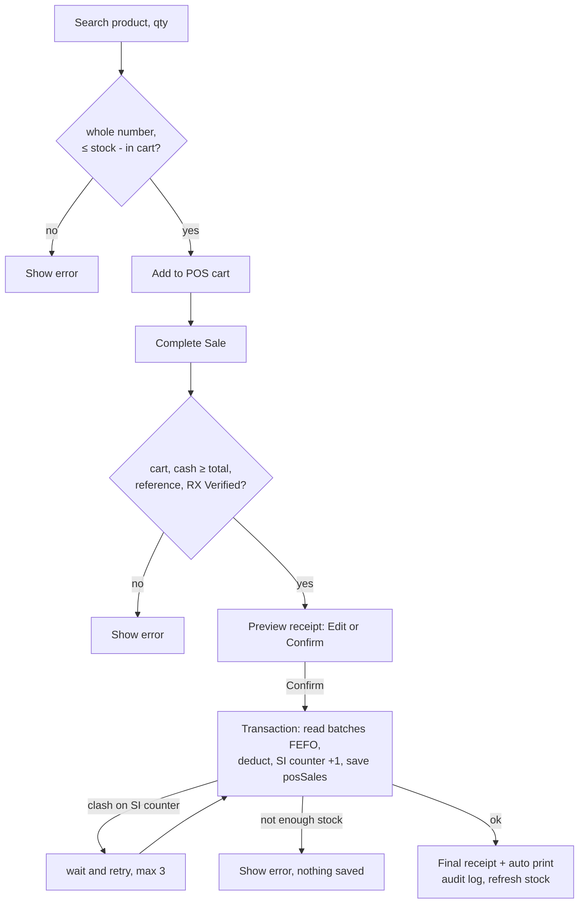
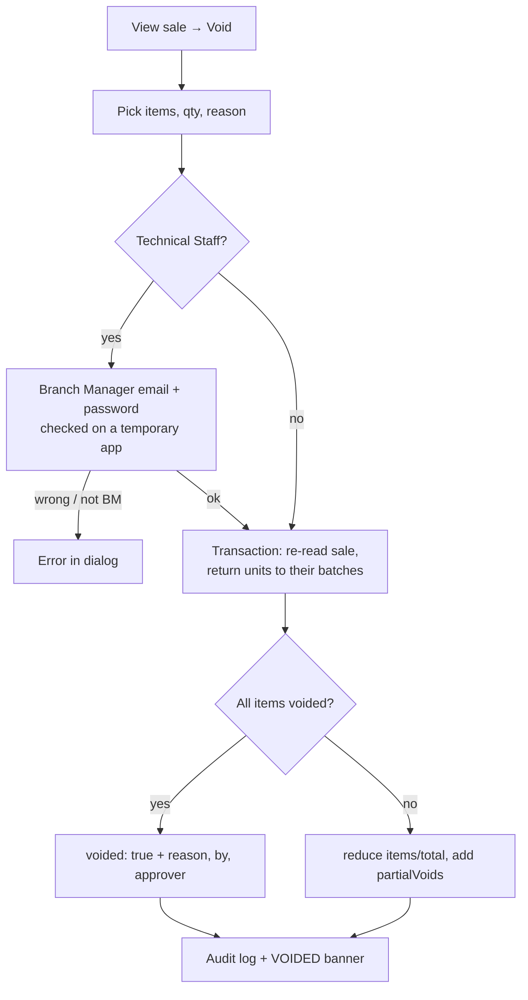

# 06 - POS (Point of Sale), Voids and Exchanges

**Files:** `admin/pos.html` + `js/admin-pos.js`; in `js/products-data.js`: receipts (`showSaleReceipt`, lines 1325-1478),
voids (lines 1488-1745), FEFO + SI numbers (`deductStockFEFOMultiple`, lines 1837-1974), walk-in returns/exchanges
(lines 2063-2370); `css/style.css:2100-2140` (58 mm receipt printing); `firestore.rules` (posSales, stockBatches, counters).

---

## 1. What it does and why Amson needs it

- The **POS** is the counter screen for **walk-in customers**. The cashier searches a product, adds quantities, picks a
  payment method (cash, G-Cash/QR Ph, bank transfer, card terminal, credit), and completes the sale.
- Every sale **deducts stock immediately** (oldest expiry first) and gets the next **SI number** (Sales Invoice), the same
  running number used for online and wholesale sales. That's what the branch's books need.
- **Rx items** need the cashier to tick **"RX Verified"** after checking the customer's prescription.
- A **receipt** prints on the branch's **58 mm thermal printer**.
- **Voids** cancel a whole sale or some items (e.g. a wrong item rung up) and put the stock back. Technical Staff need the **Branch Manager's password** to approve a void, which is an anti-fraud control.
- **Returns/exchanges** follow Amson's **no-refund** policy: the customer swaps for an item of equal or higher value and pays any difference. The returned item is either put back in stock or set aside (pulled out).

---

## 2. Walkthrough

### 2.1 Opening the POS (`admin-pos.js:48-59`)

On `admin:ready`: remember the cashier's name and role, show **Return / Exchange** only to roles that may void
(`roleCanVoidSales`, `products-data.js:1488`: admin, branch manager, technical staff), load today's sales, start a
live listener on today's sales (so sales from **other counters** appear), then fill the searchable product box.

```js
function posEligibleProducts() {                       // admin-pos.js:85
  return CATALOG_PRODUCTS.filter((p) => p.status === "active" && p.availableInPOS);
}
```
Each option reads like "Biogesic 500mg - ₱5.00 (120 in stock)", sorted by name, inside a **Choices.js** search box (`makeSearchableSelect`).

### 2.2 Adding items (`posAddItemBtn`, `admin-pos.js:113-143`)

```js
const qty = wholeQty(posQtyInput.value);
if (!product || !qty || qty <= 0) { ... "enter a whole-number quantity of at least 1." ... }
const available = posAvailableQty(productId);
if (qty > available) { posAddItemError.textContent = `Only ${available} of ${product.name} left to add.`; return; }
```
- `wholeQty` (`products-data.js:1276`) accepts only digits, so "2.5", "-3" and "1e2" are refused.
- `posAvailableQty` (`admin-pos.js:106-111`) = stock − what's already in this cart, so the cashier can't add the same item twice past the stock.

### 2.3 Complete Sale (`posCompleteSaleBtn`, `admin-pos.js:239-365`)

Checks first (each shows an error and stops):
1. the cart isn't empty;
2. for cash, cash received ≥ total ("Cash received is less than the total.");
3. G-Cash, bank or terminal payments need a valid **reference number** (`isValidReferenceNumber`);
4. Rx items need **RX Verified** ticked (`admin-pos.js:271-276`).

Then a **preview receipt** ("Review Transaction") with **Edit Transaction** / **Confirm Transaction**. **Nothing is saved until Confirm.**

On Confirm (`admin-pos.js:296-363`):
```js
const saleRef = db.collection("posSales").doc();
const stockVersion = liveVersion("stockBatches");
const { invoiceNo } = await deductStockFEFOMultiple(
  items.map((item) => ({ productId: item.productId, qty: item.qty })),
  { record: { ref: saleRef, mode: "set",
      build: (allocations, invoiceNo) => ({
        invoiceNo, customerName,
        items: items.map((item, idx) => ({ ...item, ...batchFieldsFromAllocation(allocations[idx]) })),
        total, paymentMethod, referenceNo: referenceNo || null,
        cashReceived: isCash ? cash : paymentMethod === "credit" ? 0 : total,
        change: isCash ? cash - total : 0,
        cashier: currentStaffName, branch: POS_BRANCH_NAME,
        rxVerified: rxIncluded, rxNotes: rxIncluded ? rxNotes : "",
        createdAt: serverTimestamp() }) } });
```
Line by line:
- `db.collection("posSales").doc()` makes a new document id **before** saving, so the transaction can write to it.
- `liveVersion("stockBatches")` remembers the current stock version, so after the sale the POS reloads stock only once the change has arrived (`loadCatalogCache({ afterStockChange })`).
- `deductStockFEFOMultiple` runs **one transaction** that:
  1. re-reads every candidate batch;
  2. takes units oldest-expiry-first;
  3. bumps `counters/salesInvoices` by 1;
  4. saves the sale.
  If any product is short, the whole thing fails: "Not enough stock available to fulfill this quantity."
- `batchFieldsFromAllocation` (`products-data.js:1958`) records **which batches** each item came from. Voids and returns need this.

Afterwards: the cart clears, stock refreshes, the **final receipt** ("Sale Complete", with the SI number) opens and the print window opens automatically (`autoPrint: true` → `window.print()`, `products-data.js:1355`), and an audit log entry "Walk-in Sale" is written.

> **Retry for two counters at once:** both transactions bump the SI counter. The rules only allow `count + 1`
> (`firestore.rules:320-321`), so the slower one is refused with `permission-denied`. `deductStockFEFOMultiple`
> (`products-data.js:1837-1849`) waits a moment and **re-runs the whole sale** (up to 3 more tries). Tested: 16 of 16 simultaneous sales succeeded, with no duplicate SI numbers.

### 2.4 Receipt printing

`css/style.css:2100-2140` has an `@media print` section: when printing, only the receipt is shown, **58 mm** wide,
with names wrapping. `printPdf` / `window.print()` open the browser's print dialog for the thermal printer.

### 2.5 Voids (`promptVoidDetails` → `voidPosSale`, `products-data.js:1493-1656`)

From **Today's Sales → View → Void** (`openPosSaleReceipt`, `admin-pos.js:451-497`):

1. **Dialog** (`promptVoidDetails`, 1493-1544): tick items, set how many of each to void (1 to the quantity sold), type a **reason** (required).
2. **Approval**: if the user is Technical Staff (`requireApproval: currentStaffRole === "technical_staff"`, `admin-pos.js:473`), the Branch Manager types their **email and password** in the same dialog.
   `verifyVoidApprover` (1567-1582) signs the manager in on a **separate temporary Firebase app**, so the cashier stays logged in:
   ```js
   const app = firebase.initializeApp(firebaseConfig, `VoidApproval${Date.now()}`);
   const cred = await app.auth().signInWithEmailAndPassword(email, password);
   const doc = await db.collection("users").doc(cred.user.uid).get();
   if (!["branch_manager", "admin"].includes(data.role)) throw new Error("That account isn't a Branch Manager...");
   return { approvedBy: name, approverApp: app };   // the manager stays signed in on this app
   ```
   The manager stays signed in on that app until the void is saved. `voidPosSale` (1591) then saves the void
   **through the manager's connection** (`approverApp.firestore()`), so the database sees the Branch Manager
   making the change, and signs the manager out and deletes the app afterwards (`closeApproverApp`, 1584), even if the void fails.
   This matters because the rules only let a manager void (see section 6), so the approval can't be skipped from the browser console.
3. **The void transaction** (`voidPosSaleAs`, 1600-1656):
   - re-reads the sale; stops if it was already voided;
   - `takeVoidedUnits` (1674-1703) works out which **batches** get units back (from the batch list saved on the sale; old sales without batch info go back to the latest-expiring active batch, `findFallbackBatches`);
   - adds the units back to those batches;
   - **full void** (every item at 0) → `voided: true`, reason, who voided, who approved, when. Quantities are kept for the record, and `voided: true` removes it from totals and reports;
   - **partial void** → reduces the item quantities and `total`, keeps `originalTotal`, and appends to `partialVoids` (lines, amount, reason, who, approver, when).
4. An audit entry ("Walk-in Sale Voided" / "Walk-in Sale Items Voided") with before/after totals and the reason. The receipt reopens showing a **VOIDED** banner.

### 2.6 Returns / exchanges (`processWalkinExchange`, `products-data.js:2084-2212`)

Started from the POS **Return / Exchange** button (type the SI number) or from a receipt.
1. `checkWalkinExchange` (2074-2099): the sale exists and isn't voided; the return qty ≤ what's left on that line; a reason is required; and the replacement value must be **≥ the returned value** ("Refunds aren't given").
2. `saveWalkinExchange` (2102-2178) uses the same FEFO engine to take the **replacement** out of stock, and in the same transaction:
   - **"Back to stock"** → returned units go back to the batches they came from (`planBatchReturn`, latest expiry first);
   - **"Set aside"** → a `writeOffs` record ("Customer return (EX-00001), not resold: …") instead of restocking;
   - marks `returnedQty` on the sale line, numbers the exchange `EX-00001` (`counters/wholesaleExchanges`), and saves a `wholesaleExchanges` record with `kind: "walkin"` and the price difference to collect.
3. Audit log "Walk-in Return / Exchange"; option to print an **exchange slip** PDF.

---

## 3. Flowcharts

### Sale


### Void


---

## 4. Design decisions

| Decision | Why | Alternatives we didn't use |
| --- | --- | --- |
| Preview receipt before saving | Cashiers catch wrong items/quantities **before** stock and an SI number are used, which means fewer voids. | Save immediately (more voids, more paperwork). |
| One transaction for stock + SI number + sale | Never an SI number without a sale, never a sale without stock deducted. | Separate writes (a crash in between leaves numbering gaps or wrong stock). |
| One SI counter for walk-in, online and wholesale | The branch keeps one continuous sales-invoice series, as its books and BIR-style records expect. | Separate series per channel. |
| Retry on counter clash | Two counters can sell at the same instant; the rules refuse the stale number, so we retry the whole sale. | Letting the rules allow any number (allows tampering/duplicates). |
| Void keeps the record (`voided: true`) instead of deleting | Audit trail: a voided SI number still exists with a reason, who voided it and who approved. | Deleting sales (hides fraud; the rules forbid it anyway). |
| BM password for Technical Staff voids, checked on a separate Firebase app | Two-person control against "void and pocket the cash". The separate app keeps the cashier signed in. | No approval (fraud risk), or logging the cashier out. |
| No refunds, exchanges only, replacement ≥ returned value | Amson's store policy. | Cash refunds. |
| Batches recorded on each sold line | Returns and voids put units back into the exact batch (keeps expiry tracking right). | Returning to any batch (expiry records drift). |

---

## 5. What happens if…

1. **…two counters sell the last 5 units at the same moment?** Both transactions read 5. The first saves; the second's transaction re-runs, sees 0, and fails: "Not enough stock available to fulfill this quantity." (tested)
2. **…two counters complete different sales at the same moment?** Both bump the SI counter; the rules refuse the stale one; it retries and gets the next number. No duplicate SI numbers.
3. **…the internet drops on Confirm?** The transaction fails: no stock change, no SI number used, no sale. The error shows in red; the cart is still there to try again.
4. **…the cashier types 2.5 or -1?** "Search for a product, pick it from the list, and enter a whole-number quantity of at least 1."
5. **…a Sales Staff member tries to void?** There's no Void or Return button for them (`roleCanVoidSales`). If they call it from the console, the rules refuse the `posSales` update (a void needs `isManager()`).
6. **…Technical Staff try to approve their own void with their own password?** `verifyVoidApprover` checks the approver's role, so a non-manager account gets "That account isn't a Branch Manager, so it can't approve voids." (tested)
7. **…the wrong BM password is typed?** "The Branch Manager's email or password is incorrect." The dialog stays open; nothing is voided.
8. **…someone tries to void an already-voided sale (two windows)?** The transaction re-reads the sale: "This sale was already voided."
9. **…a returned item's batch was deleted?** "The batch the item came from no longer exists; it can't be returned to stock automatically." Staff can choose "Set aside" instead.
10. **…the customer wants a cheaper replacement and the difference in cash?** Refused: "The replacement (₱X) must be of equal or higher value than the returned items (₱Y). Refunds aren't given."
11. **…a sold item is in a near-expiry batch?** The POS sells only retail-sellable batches (expiring more than 6 months away). Near-expiry units aren't offered at the counter.
12. **…an Rx item is sold without ticking RX Verified?** "Check the customer's prescription and tick RX Verified before completing this sale."
13. **…the printer isn't connected?** The sale is already saved; the cashier can reprint later from Today's Sales → View → Print.

---

## 6. Security rules for this module

| Rule (`firestore.rules`) | What it blocks |
| --- | --- |
| `posSales` read/create: `isStaff()` (224) | Customers and guests seeing or creating walk-in sales. |
| `posSales` update: `isManager()` (225-226) | Anyone but the Branch Manager voiding or changing a sale's total. Technical Staff voids are saved through the manager's approval login. |
| `posSales` update by ops staff: only `items` may change (227-229) | Technical Staff editing totals or void fields; they may only mark returned units during an exchange. |
| no `delete` on `posSales` (only the temporary clear-test rule) | Deleting sales to hide them. |
| `stockBatches` update: `isStaff()` (216) | Customers changing stock (the POS needs staff to update quantity). |
| `counters/salesInvoices`: create = 1, update = +1, staff only (316-321) | Resetting or skipping SI numbers. |
| `wholesaleExchanges`, `writeOffs`: ops staff (234, 237) | Sales Staff recording exchanges or pull-outs. |
| `auditLog` append-only (250) | Erasing evidence of voids. |

---

## 7. Known limitations and how we'd improve them

1. **Technical Staff can still change a sale's `items` from the console** (exchanges need that), though not its total or void fields. **Improve:** a Cloud Function for exchanges, so the rules can lock `items` too.
2. **POS prices come from the browser** (the catalog loaded on that computer). Staff can't type prices, but a console user could. **Improve:** server-side pricing.
3. **Any staff role can update any field of a stock batch** (the rules allow `isStaff()` so the POS can deduct). **Improve:** limit Sales Staff to decreasing `quantity` only.
4. **Printing uses the browser's print dialog**; printer setup (58 mm paper, no margins) must be done once per computer.
5. **The audit log's "user" name is written by the browser.** A console user could fake the name. **Improve:** store the uid and check it in the rules.

---

## 8. Likely panel questions

1. **"How does the POS decide which batch to sell from?"** FEFO, first expiry first out. `deductStockFEFOOnce` sorts candidate batches by `expirationDate` and takes from the earliest (`products-data.js:1863-1866`, `1898-1913`).
2. **"How do you prevent two cashiers from selling the same last item?"** Firestore transactions: the second transaction re-reads the batch, sees no stock, and fails.
3. **"What's an SI number and how is it generated?"** The Sales Invoice number, 8 digits (`formatInvoiceNo`, `products-data.js:1972`). It comes from `counters/salesInvoices` inside the sale's transaction; the rules allow only +1.
4. **"Why preview the receipt before saving?"** To catch mistakes before stock and an SI number are used.
5. **"Who can void, and why does Technical Staff need approval?"** Branch Manager and Technical Staff; Technical Staff need the BM's password. It's a two-person rule against fraud.
6. **"How is the manager's password checked without logging the cashier out?"** The manager signs in on a temporary second Firebase app (`verifyVoidApprover`, `products-data.js:1567`). The void is saved through that app as the manager, then the app is signed out and deleted.
   **Follow-up: "So can't Technical Staff skip the approval from the console?"** No. The rules only let a Branch Manager void (`firestore.rules:225-229`), so without the manager's login the database refuses it.
7. **"Do you delete voided sales?"** No. We mark them `voided: true` with the reason, who voided and who approved, so reports skip them but the record stays for audit.
8. **"What happens to the stock in a void?"** It goes back to the exact batches the units came from, in the same transaction (`voidPosSaleAs`, lines 1620-1630).
9. **"Can a customer get a cash refund?"** No, it's Amson's policy. Exchanges only, for equal or higher value; the customer pays the difference (`checkWalkinExchange`).
10. **"What if a returned item can't be resold?"** Staff choose "Set aside", which records a pull-out (`writeOffs`) instead of restocking.
11. **"Why can't Sales Staff void?"** Separation of duties: the person taking cash shouldn't be able to cancel sales. The UI hides it and the rules refuse it.
12. **"How does the receipt fit the 58 mm printer?"** A print stylesheet (`@media print` in `css/style.css:2100`) shows only the receipt at 58 mm width.
