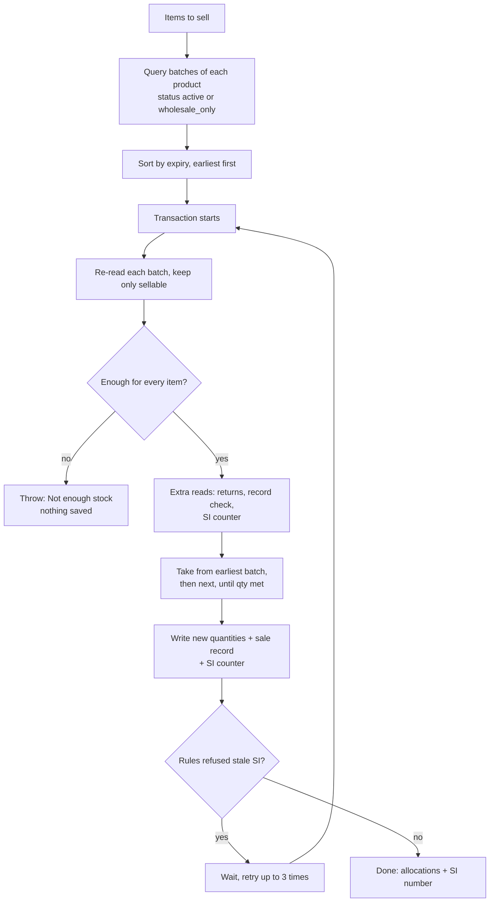
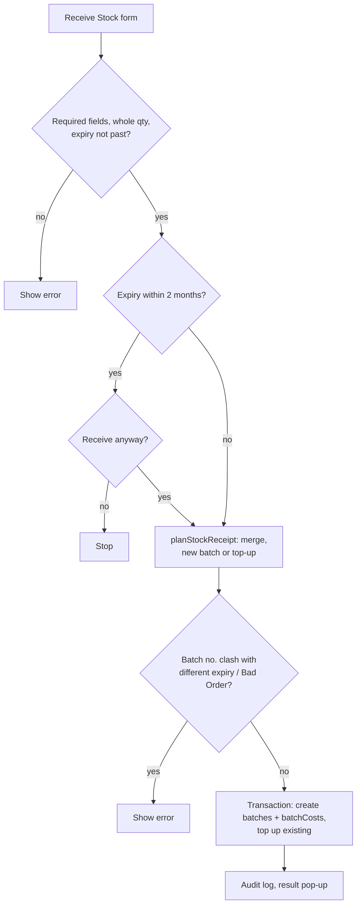

# 07 - Inventory and FEFO (First Expiry, First Out)

**Files:** `admin/inventory.html` + `js/admin-inventory.js` (receive stock, purchase orders, write-offs, stock counts),
`js/admin-opening-stock.js` (first count), `js/admin-suppliers.js`; in `js/products-data.js`: the FEFO engine
`deductStockFEFOMultiple` / `deductStockFEFOOnce` (lines 1812-1945), stock status helpers (243-346), live reads (795-888);
`firestore.rules` (stockBatches, batchCosts, writeOffs, reconciliations, purchaseOrders, suppliers).

---

## 1. What it does and why Amson needs it

- Stock is tracked **per batch** (lot): each delivery of a product has its own **batch number, expiry date and quantity**.
  Medicines expire, and the same product can be on the shelf in batches with different expiry dates.
- **FEFO** (first expiry, first out) means every sale takes units from the batch that **expires soonest**, so old stock doesn't sit until it expires. This reduces losses, and it's standard practice for pharmacies.
- The **Inventory page** lets staff:
  - **Receive stock** (by hand, by Excel, or against a **Purchase Order**), with supplier, receipt/DR number, cost, batch and expiry;
  - **Write off** damaged, lost or expired units with a reason;
  - do a **stock count** (reconciliation): staff count the shelves, and the **Branch Manager finalizes** it to correct the system;
  - see **alerts**: low stock, out of stock, near expiry, expired;
  - load the **opening stock** once, at go-live.
- Every change is recorded in the **audit log**, and purchase costs stay private (`batchCosts`).

---

## 2. Walkthrough

### 2.1 The FEFO engine (`deductStockFEFOOnce`, `products-data.js:1832-1936`)

Used by POS sales, online approvals, wholesale orders and exchanges.

**Step 1, find candidate batches (outside the transaction, lines 1836-1851):**
```js
const candidates = await db.collection("stockBatches")
  .where("productId", "==", item.productId)
  .where("status", "in", allowedStatuses)        // ["active"] or, for wholesale, ["active", "wholesale_only"]
  .get();
const refsInFefoOrder = candidates.docs
  .map((doc) => ({ ref: doc.ref, expirationDate: doc.data().expirationDate }))
  .sort((a, b) => new Date(a.expirationDate) - new Date(b.expirationDate))   // earliest expiry first
  .map((b) => b.ref);
```
A transaction can't run a query, so we query first, then **re-read each batch inside** the transaction.

**Step 2, inside the transaction, check every item before writing anything (1853-1872):**
```js
for (const ref of item.refsInFefoOrder) {
  const doc = await transaction.get(ref);
  if (doc.exists && isSellable(doc.data())) batches.push({ ref, quantity: data.quantity, batchNo, expirationDate });
}
const totalAvailable = batches.reduce((sum, b) => sum + b.quantity, 0);
if (totalAvailable < item.qty) throw new Error("Not enough stock available to fulfill this quantity.");
```
- `isSellable` is `isRetailSellableBatch` (active, more than 6 months to expiry) for retail, or `isWholesaleSellableBatch` (active or wholesale-only, not yet expired) for wholesale.
- Throwing an error **cancels the whole transaction**: nothing is written.

**Step 3, the extra reads, still before any write (1874-1892):** batches receiving returned units, any extra docs, the `record.check` (e.g. "is the order still placed?"), and the SI counter.

**Step 4, plan the deductions (1894-1913):**
```js
for (const item of perItemBatches) {
  let remaining = item.qty;
  for (const batch of item.batches) {
    if (remaining <= 0) break;
    const current = newQty.has(batch.ref.id) ? newQty.get(batch.ref.id) : batch.quantity;
    const deduct = Math.min(current, remaining);
    newQty.set(batch.ref.id, current - deduct);
    used.push({ batchId: batch.ref.id, batchNo: batch.batchNo, expirationDate: batch.expirationDate, qty: deduct });
    remaining -= deduct;
  }
}
```
Example: 15 units wanted; batch A (exp. March 2027) has 10, batch B (exp. Aug 2027) has 50 → take 10 from A, 5 from B.
`newQty` remembers new amounts, so if the same product appears twice in one sale, the second line sees what's left.

**Step 5, write (1914-1934):** one `update` per batch with the new `quantity`, then the sale/order record (`record.build(allocations, invoiceNo)`), then any extra writes. All saved together.

**Step 6, retry wrapper (`deductStockFEFOMultiple`, 1818-1830):** if the rules refuse a stale SI number because two counters clashed (`permission-denied`), try again after a short random pause, up to 3 more times.

### 2.2 Receive stock (`saveReceiveStockBtn`, `admin-inventory.js:697-757`)

1. Read every row: product, **whole-number** quantity (`wholeQty`), batch no., expiry, optional unit cost.
2. Checks:
   - supplier, date and receipt/DR no. are required;
   - every item needs product, qty, batch and expiry;
   - **a past expiry date is refused** ("expired stock can't be received", `expiryPassed`, line 614);
   - expiry within 2 months asks "Receive anyway?" (`confirmExpiringSoon`, line 619), because it would go straight to Bad Order.
3. `planStockReceipt` (`admin-inventory.js:488-518`) decides what each line becomes:
   - same product + same batch no. typed twice → quantities merged; **different expiry for the same batch no. → error** (one batch has one expiry);
   - batch already exists → a **top-up** (adds to it, keeps a `deliveries` history);
   - batch already written off as Bad Order → refused;
   - otherwise → a **new batch**.
4. Save in **one transaction** (`applyStockReceipt`, 537-594): new batches get `status: "active"`, `initialQuantity`, supplier and receipt details, and their cost goes to `batchCosts` (staff-only). Top-ups re-read the batch and add to it. "All or nothing so a retry can't add stock twice" (comment at line 732).
5. Audit log "Stock Received", then a result pop-up listing each line.

**Purchase orders** (`submitPoReceiving`, 2099-2186): the received quantity per PO line is compared with what was ordered. Any difference makes the PO status `discrepancy` (for the PO Discrepancy report), otherwise `received`. Stock and PO status save in one transaction, and a PO can't be received twice ("This delivery was already recorded").

**Opening stock** (`admin-opening-stock.js`): at go-live, staff download a count sheet, fill in batch, expiry and quantity, and upload it once. Batches are saved with `source: "opening_stock"`, so the Supplier Purchases report doesn't count them as purchases.

### 2.3 Write off (`saveWriteOff`, `admin-inventory.js:1260-1301`)

1. Each row: product → **batch of that product** (`populateBatchSelectForProduct`, 1128-1146 clears the old batch pick when the product changes), qty and reason.
2. `writeOffProblem` (1242-1257): every row needs a batch, qty and reason; qty can't exceed the batch; **the batch must belong to the chosen product**.
3. The transaction re-reads each batch, refuses if the quantity is now too high, subtracts, and creates a `writeOffs` record per row (reason and date) in the same transaction.
4. One audit entry per row, with before/after units.

### 2.4 Stock count (reconciliation), lines 1319-1716

1. **Open a count** for a month: a snapshot of every active/wholesale-only batch with its `systemQty` is saved as `reconciliations/{id}` with an `RCN-…` number.
2. Staff type the counted quantity for each batch. Blank boxes and anything that isn't a whole number of 0 or more are refused (lines 1588-1602).
3. **Technical Staff** → `saveCountForManager` (1639-1651) saves the count only: "Only the Branch Manager can finalize it."
4. **Branch Manager** → `askVarianceReason` (1654-1672): if any batch differs, a reason is required. Then `finalizeCount` (1675-1715):
   ```js
   transaction.update(refs[idx], { quantity: Math.max(0, (doc.data().quantity || 0) + changed[idx].variance), ... });
   ```
   It applies the **difference** (counted − system) to the **current** quantity, not the old snapshot, so sales made *during* the count aren't lost. Then it marks the count `finalized` and logs every changed batch (`systemQty -> countedQty`) with the reason.

### 2.5 Alerts and status

- `getStockLevelStatus` (`products-data.js:285-293`): out of stock = 0; **low stock** = at or below the product's `reorderPoint` (default 20).
- `getExpiryStatus` (295-305): expired, or **near expiry** = within 6 months.
- `computeInventoryAlertCounts` (324-346) gives the four tile numbers on Inventory and the Dashboard.
- The Inventory table **listens live** (`listenToBatches`, `admin-inventory.js:181-223`), so a sale at the POS shows up without refreshing.

---

## 3. Flowcharts

### FEFO deduction


### Receive stock


---

## 4. Design decisions

| Decision | Why | Alternatives we didn't use |
| --- | --- | --- |
| Stock per batch, not per product | Each batch has its own expiry; FEFO, expiry alerts and Bad Order need it. | One stock number per product (can't do FEFO or expiry). |
| FEFO, not FIFO | In pharmacy, what matters is the expiry date, not when it arrived. A later delivery can expire sooner. | FIFO (first in, first out). |
| Query outside, re-read inside the transaction | Firestore transactions can't run queries; re-reading guarantees the numbers are current. | Trusting the query result (two sales could both take the same units). |
| All reads before writes | Firestore requires it inside a transaction. | n/a |
| Retry on `permission-denied` for the SI counter | Our strict "+1 only" rule refuses clashes instead of letting Firestore retry. | Loosening the rule (would allow tampering). |
| One batch number = one expiry | Matches the physical box. Typing the same batch with a different expiry is almost always a typo. | Allowing it (two "batches" with the same number). |
| Cost in `batchCosts`, not on the public batch | `stockBatches` must be public for the shop; purchase costs are business secrets. | Hiding the whole batch collection (the shop couldn't show stock). |
| Stock count applies differences, not absolute numbers | Sales keep happening during a count; overwriting would undo them. | Setting quantity = counted (loses sales made meanwhile). |
| Branch Manager finalizes counts | Changing stock numbers is sensitive (theft can be hidden by "adjusting"). | Anyone finalizes. |

---

## 5. What happens if…

1. **…two people sell the last units of a batch at the same time?** The transaction makes the second one re-run; it sees the new quantity and either takes from the next batch or fails with "Not enough stock".
2. **…a sale needs units from two batches?** It takes all of the earliest batch, then the rest from the next one; the sale records both batches.
3. **…staff receive stock with an expiry date in the past (e.g. typo 2020)?** Refused: "An expiry date has already passed. Check the date on the box - expired stock can't be received." (Receive form and Excel upload.)
4. **…the same batch number is typed with two different expiry dates?** "Batch X of Y is entered twice with different expiry dates." Nothing saves.
5. **…the internet drops while saving a receipt?** The transaction fails as a whole; no half-received delivery. Retry is safe (no double stock).
6. **…someone writes off more than a batch has?** Refused on the form, and refused again inside the transaction if another sale reduced the batch meanwhile.
7. **…someone picks a product, then a batch, then changes the product?** The batch list is cleared and reloaded for the new product, and saving checks the batch belongs to that product (bug #1 from testing, fixed).
8. **…Technical Staff try to finalize a stock count?** They can only "save for the manager". The Branch Manager must finalize.
9. **…someone types -5 or 3.7 in a count?** "N counts aren't a whole number of 0 or more." The boxes are highlighted.
10. **…sales happen during a stock count?** Finalizing applies only the *difference* counted − system, to the current quantity, so those sales aren't lost.
11. **…a Purchase Order delivery is short?** The PO is saved as `discrepancy`, with expected vs received, and appears in the PO Discrepancy report and staff notifications.
12. **…a customer tries to change stock from the console?** Refused: `stockBatches` update needs `isStaff()`.
13. **…a batch's product was deleted?** The inventory row offers "Delete leftover record" (`deleteOrphanBatch`, line 371).

---

## 6. Security rules for this module

| Rule (`firestore.rules`) | What it blocks |
| --- | --- |
| `stockBatches` read: public; update: `isStaff()`; create/delete: `isOpsStaff()` (213-217) | Customers changing stock; Sales Staff creating or deleting batches. |
| `batchCosts`: ops staff only (219-221) | Customers and Sales Staff seeing purchase costs. |
| `writeOffs`, `reconciliations`, `purchaseOrders`, `suppliers`: ops staff (226-229) | Sales Staff and customers reading or writing back-office records. |
| `counters`: staff; `salesInvoices` +1 only (308-316) | Tampering with SI / PO / count numbers. |
| `auditLog`: append-only (235-246) | Hiding adjustments. |

---

## 7. Known limitations and how we'd improve them

1. **Only the page stops Technical Staff from finalizing a count.** The rules let any ops staff update batch quantities (needed for receiving and write-offs). **Improve:** a rule-checked "finalized by manager" record, or a Cloud Function.
2. **Any staff, including Sales Staff, can update any field of a batch** (the POS needs to reduce quantity). **Improve:** a rule that lets Sales Staff only decrease `quantity`.
3. **Receiving against a Purchase Order** doesn't yet refuse a past expiry date or a decimal quantity the way the Receive Stock form does (it uses `parseInt`). **Improve:** reuse `expiryPassed` and `wholeQty` there.
4. **Public stock records still show some back-office fields** (supplier id, receipt no., disposal note). **Improve:** move them to a staff-only collection like `batchCosts`.
5. **Two staff editing the same record at once:** the second save wins without a warning (for edit forms, not for stock quantities, which use transactions).
6. **No barcode scanning** yet; products are searched by name. **Improve:** read barcodes into the search box.

---

## 8. Likely panel questions

1. **"What is FEFO and where is it in your code?"** First Expiry, First Out. `deductStockFEFOOnce` sorts batches by expiry and takes from the earliest (`products-data.js:1844-1847`, `1898-1913`).
2. **"Why not FIFO?"** A batch delivered later can expire earlier. Selling by expiry minimizes expired stock.
3. **"How do you guarantee stock never goes negative?"** Inside the transaction we re-read each batch and throw if the total is too small (`1866-1869`); deductions use `Math.min(current, remaining)`.
4. **"What is a transaction and why use it here?"** A group of reads and writes that happen all together or not at all, and retry if the data changed. Two cashiers can't both sell the same unit.
5. **"Why do you query outside the transaction?"** Firestore transactions can only read documents by reference, not run queries, so we find the batch references first and re-read them inside.
6. **"How do you keep purchase costs private if batches are public?"** Costs are saved in `batchCosts`, readable only by ops staff (`firestore.rules:219-221`).
7. **"Who can change stock numbers by hand?"** Write-offs (Technical/BM, with a reason) and finalized stock counts (Branch Manager, with a reason). Both are logged.
8. **"What happens if the count differs from the system?"** The Branch Manager must give a reason; the difference is applied to current stock and logged with before/after numbers.
9. **"How are low-stock alerts calculated?"** Total stock at or below the product's reorder point (default 20) (`getStockLevelStatus`, `products-data.js:285`).
10. **"What's opening stock?"** The first count when the system starts. It's marked `source: "opening_stock"` so it isn't counted as a supplier purchase.
11. **"How does the system know a PO delivery was short?"** It compares received vs expected per line and saves the differences (`submitPoReceiving`, `admin-inventory.js:2146-2154`).
12. **"Why does a receipt top up an existing batch instead of making a new one?"** The same batch number from the same product is the same physical lot with the same expiry; keeping one record keeps FEFO and expiry tracking correct, with a `deliveries` history.
