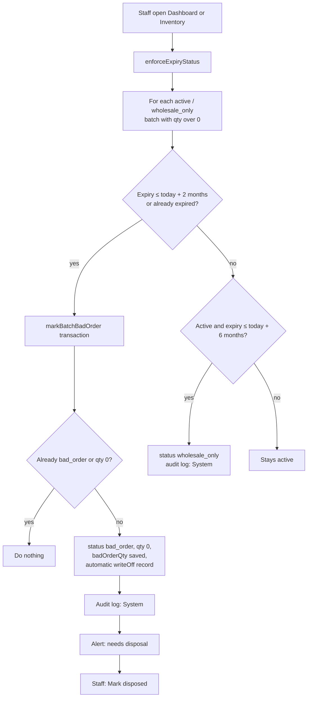

# 08 - Expiry Monitoring and Bad Order

**Files:** `js/products-data.js`: expiry rules (`enforceExpiryStatus`, `markBatchBadOrder`, lines 691-782), stock status
helpers (`isRetailSellableBatch`, `isWholesaleSellableBatch`, `getExpiryStatus`, lines 245-311), staff alerts
(`expiryAlerts`, `badOrderAlerts`, lines 490-589); `js/admin-inventory.js` (runs the rules on load, Bad Order tab,
`markBatchDisposed` line 345); `js/admin-dashboard.js:207` (also runs the rules); `js/admin-reports.js` (Pull-Out and
Monthly Inventory reports).

---

## 1. What it does and why Amson needs it

A pharmacy must **never sell expired medicine**, and near-expiry medicine shouldn't go to ordinary customers either.
Amson's rules, built into the system:

| Time left before expiry | Status | Who can buy it |
| --- | --- | --- |
| More than **6 months** | `active` | Retail (shop + POS) and wholesale |
| **6 months or less** | `wholesale_only` ("Near Expiry") | Wholesale buyers only (they sell it quickly) |
| **2 months or less**, or already expired | `bad_order` | Nobody. Quantity goes to 0, an automatic **write-off** is recorded, and staff must **pull it out and dispose of it**. |

The two numbers are settings: `NEAR_EXPIRY_MONTHS = 6` (`products-data.js:247`) and `BAD_ORDER_MONTHS = 2` (line 694).

Why automatic? Staff are busy; a forgotten box of expired medicine sold to a customer is a health risk and a
regulatory (FDA) problem. The system moves batches by itself and reminds staff to dispose of them.

---

## 2. Walkthrough

### 2.1 When does the check run?

There's no server running on a timer (free plan), so the check runs **whenever staff open**:
- the **Inventory** page: `await enforceExpiryStatus(allBatches);` (`admin-inventory.js:154`, inside `loadInventory`);
- the **Dashboard**: `await enforceExpiryStatus();` (`admin-dashboard.js:207`).

Staff open the dashboard at the start of every day, so in practice it runs daily.

Independently of the stored status, the shop and POS **never count a batch within 6 months of expiry** for retail,
because `isRetailSellableBatch` compares the expiry date with today on every load (`products-data.js:256-258`).
So even before `enforceExpiryStatus` runs, near-expiry stock can't be sold at retail.

### 2.2 `enforceExpiryStatus()` line by line (`products-data.js:697-730`)

```js
const batches = (batchesOverride || all batches).filter((b) => b.status === "active" || b.status === "wholesale_only");
```
Only look at batches that can still be sold.

```js
const wholesaleOnlyThreshold = new Date(); wholesaleOnlyThreshold.setMonth(wholesaleOnlyThreshold.getMonth() + NEAR_EXPIRY_MONTHS);
const badOrderThreshold = new Date();     badOrderThreshold.setMonth(badOrderThreshold.getMonth() + BAD_ORDER_MONTHS);
```
Two cut-off dates: today + 6 months, and today + 2 months.

```js
for (const batch of batches) {
  if (batch.quantity <= 0) continue;            // empty batches are left alone
  const expiry = new Date(batch.expirationDate);
  if (isNaN(expiry)) continue;                  // a bad date is skipped, not crashed on
  if (expiry <= badOrderThreshold) {
    await markBatchBadOrder(batch.id);
  } else if (batch.status === "active" && expiry <= wholesaleOnlyThreshold) {
    await db.collection("stockBatches").doc(batch.id).update({ status: "wholesale_only" });
    await logAuditEvent({ action: "Batch Moved to Wholesale Only", actor: "System", before: "Active (retail + wholesale)", after: "Wholesale only", reason: "Within 6 months of expiry", ... });
  }
}
```
- Within 2 months (or expired) → Bad Order.
- Else, active and within 6 months → Wholesale Only, logged with actor **"System"**.

### 2.3 `markBatchBadOrder()` line by line (`products-data.js:732-776`)

```js
await db.runTransaction(async (tx) => {
  const doc = await tx.get(ref);
  if (!doc.exists) return;
  const batch = doc.data();
  if (batch.status === "bad_order" || (batch.quantity || 0) <= 0) return;   // another page may have done it already
  const expired = batch.expirationDate < localISODate(new Date());
  const reason = expired
    ? `Bad Order - expired on ${formatDateMDY(batch.expirationDate)}, deducted automatically`
    : `Bad Order - within 2 months of expiry (${formatDateMDY(batch.expirationDate)}), deducted automatically`;
  tx.update(ref, { status: "bad_order", quantity: 0, badOrderQty: batch.quantity, badOrderAt: serverTimestamp(), lastAdjustedAt: serverTimestamp() });
  tx.set(writeOffRef, { batchId, productId: batch.productId, batchNo: batch.batchNo || "", quantity: batch.quantity, reason, automatic: true, createdAt: serverTimestamp() });
});
```
- **A transaction**, because the Dashboard and Inventory might run this at the same moment on two computers. The second sees `status === "bad_order"` and does nothing, so the write-off isn't recorded twice.
- The quantity moves to `badOrderQty` (kept for the record) and the batch quantity becomes 0.
- A `writeOffs` record with `automatic: true` feeds the **Pull-Out report**.
- Then an audit entry "Bad Order (Automatic Write-Off)" with before "N units" and after "0 units (Bad Order)".

### 2.4 Disposal

Bad Order batches waiting to be physically disposed of raise a staff alert:
"N Bad Order batches need to be pulled out and disposed of." (`badOrderAlerts`, `products-data.js:572-589`).
On Inventory, staff click **Mark disposed** (`markBatchDisposed`, `admin-inventory.js:345-369`). This saves `disposedAt`, `disposedBy` and a note, and logs "Bad Order Disposed".

### 2.5 Alerts and tiles

- `expiryAlerts` (`products-data.js:490-530`): an alert for each active batch with stock that is **expired** (red) or **near expiry** (amber), on the staff bell and the Notifications page.
- `computeInventoryAlertCounts` gives the **Near Expiry** and **Expired** tiles on Inventory and the Dashboard.
- **Receiving** warns before accepting stock that expires within 2 months, and refuses past dates (`admin-inventory.js:614-628`, `721-724`).

### 2.6 Wholesale can still sell near-expiry stock

Wholesale orders call the FEFO engine with `includeWholesaleOnly: true` (`admin-wholesale-accounts.js:725`), so
`isWholesaleSellableBatch` (`products-data.js:260-266`) accepts `active` **and** `wholesale_only` batches that aren't expired yet.
Because of FEFO, wholesale buyers get the **earliest-expiring** units first, which is exactly the near-expiry stock.

---

## 3. Flowchart



---

## 4. Design decisions

| Decision | Why | Alternatives we didn't use |
| --- | --- | --- |
| 6-month and 2-month thresholds as named constants | Amson's own policy; easy to change in one place. | Hard-coded numbers scattered in the code. |
| Retail stock filtered by date **at read time** | Even if the automatic move hasn't run yet today, retail can't sell near-expiry units. | Relying only on the stored status. |
| Run on Dashboard/Inventory load | The free Spark plan has no scheduled Cloud Functions. Staff open these pages daily. | A scheduled function (needs the paid Blaze plan). |
| Bad Order in a transaction | Two computers might run it at once; prevents double write-offs. | A plain update (could record the loss twice). |
| Keep `badOrderQty` and a write-off record | The Pull-Out report and FDA disposal records need the quantity and reason. | Just setting quantity to 0 (loses the history). |
| Separate "disposed" step | The system can't see the shelf; staff confirm the box was physically removed. | Assuming it's gone. |
| Near-expiry → wholesale only, not discarded | Clinics and other pharmacies use stock quickly; saves money for Amson. | Writing off at 6 months (bigger losses). |

---

## 5. What happens if…

1. **…a batch crosses the 6-month line overnight?** That morning the shop and POS stop counting it (date check at read time). When staff open the Dashboard, it's moved to Wholesale Only and logged.
2. **…a batch crosses the 2-month line?** On the next Dashboard/Inventory load: Bad Order, quantity 0, automatic write-off, audit log, disposal alert.
3. **…nobody opens the Dashboard or Inventory for a week?** The stored statuses don't change, **but** retail still can't sell near-expiry units (read-time check), and expired batches are never sellable (`isWholesaleSellableBatch` requires expiry > today). Statuses catch up on the next visit.
4. **…two staff open the Dashboard at the same moment?** Both call `markBatchBadOrder`; the transaction makes the second one see `bad_order` and stop. Only one write-off is recorded.
5. **…staff receive stock that's already expired?** Refused by the Receive form ("expired stock can't be received").
6. **…staff receive stock expiring in 6 weeks?** A warning: it will go straight to Bad Order. "Receive anyway?"
7. **…a batch has a broken expiry date?** `isNaN(expiry)` → skipped, no crash.
8. **…someone tries to sell a Bad Order batch at the POS?** Its quantity is 0 and status `bad_order`; the FEFO engine only reads `active` (or `wholesale_only`) batches.
9. **…a wholesale order needs stock and only near-expiry units exist?** Allowed: wholesale includes `wholesale_only` batches, earliest expiry first.
10. **…the same delivery batch arrives again after being written off?** `planStockReceipt` refuses: "was already written off as a Bad Order, so it can't be received again."
11. **…a customer tries to "un-bad-order" a batch from the console?** Refused: `stockBatches` update needs staff.

---

## 6. Security rules for this module

| Rule (`firestore.rules`) | What it does |
| --- | --- |
| `stockBatches` update: `isStaff()` (216) | Only staff pages (running `enforceExpiryStatus`) can change status/quantity. |
| `writeOffs` create: `isOpsStaff()` (234) | Only Technical/Branch Manager pages record write-offs. Note: Bad Order runs on Dashboard/Inventory, which Sales Staff can't open. |
| `auditLog` create: `isStaff()`, no update/delete (243, 250) | The "System" entries can't be erased. |

---

## 7. Known limitations and how we'd improve them

1. **The automatic moves need a staff page to load.** **Improve:** a scheduled Cloud Function every midnight (Blaze plan).
2. **Thresholds are the same for every product.** Some medicines might need different windows. **Improve:** per-product or per-category settings.
3. **"System" entries are written by whichever staff browser ran the check**, so the audit log shows "System", not who opened the page.
4. **Months are calendar months** (`setMonth`); edge dates (e.g. 31st) roll over JavaScript-style. Fine for a 2/6-month window.
5. **No near-expiry discount or promo feature** for customers. **Improve:** let the manager mark near-expiry items for a discount (would need a policy decision).

---

## 8. Likely panel questions

1. **"How does the system prevent selling expired medicine?"** Three layers: retail counts only batches with more than 6 months left (`isRetailSellableBatch`); wholesale only non-expired batches (`isWholesaleSellableBatch`); and batches within 2 months are automatically moved to Bad Order with quantity 0 (`markBatchBadOrder`).
2. **"What does 'wholesale only' mean?"** The batch is within 6 months of expiry: not sold to retail customers, but wholesale buyers (clinics, other pharmacies) can still buy it.
3. **"When does the automatic check run?"** When staff open the Dashboard or Inventory (`admin-dashboard.js:207`, `admin-inventory.js:154`). Retail filtering also happens at every catalog load.
4. **"Why not use a scheduled job?"** The free Spark plan doesn't include scheduled Cloud Functions; page-load checks plus read-time filtering give the same safety.
5. **"What's a Bad Order?"** A batch that's expired or within 2 months of expiry. It's written off automatically and must be physically disposed of.
6. **"How do you avoid writing it off twice?"** A transaction re-reads the batch and exits if it's already `bad_order` (`products-data.js:741`).
7. **"Where can I see what was written off?"** The Pull-Out report (`writeOffs`), the Inventory Bad Order view, and the audit log.
8. **"Why 6 months and 2 months?"** That's Amson's policy. They're constants (`NEAR_EXPIRY_MONTHS`, `BAD_ORDER_MONTHS`), so the client can change them.
9. **"How do staff know they need to dispose of something?"** A red staff notification: "N Bad Order batches need to be pulled out and disposed of" until they click Mark disposed.
10. **"Does near-expiry stock still show in the shop?"** No. The shop's stock only counts batches with more than 6 months left; if that's all there is, the product shows Out of Stock.
