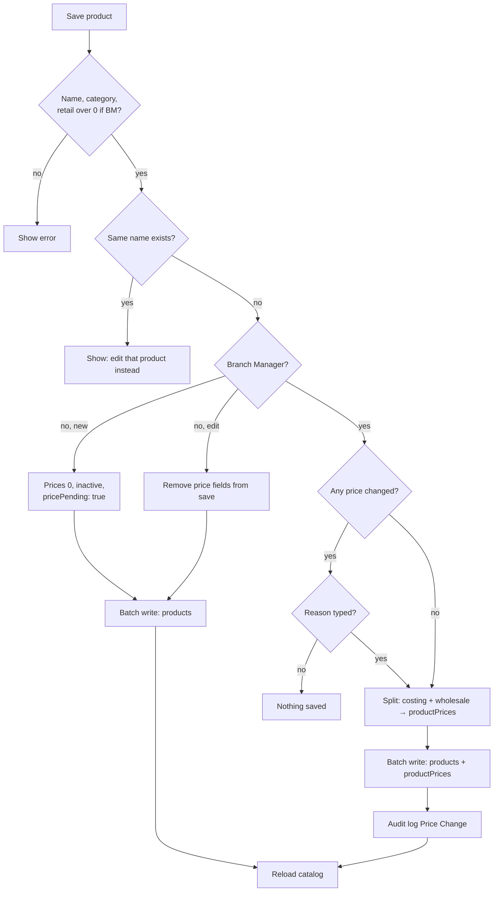

# 09 - Products and Pricing

**Files:** `admin/products.html` + `js/admin-products.js` (add/edit, prices, price lock, Excel import, categories),
`js/admin-product-photos.js` (bulk photo upload), `js/products-data.js` (`generateProductSku`, `findProductByName`,
`loadPrivatePrices`, `setPrivatePrices`), `firestore.rules` (products, productPrices, categories, counters).

---

## 1. What it does and why Amson needs it

- Staff keep the **catalog**: name, generic name, brand, category, shop section, description, dosage notes, photo,
  reorder point, whether it needs a **prescription**, and whether it's sold **online**, at the **POS**, or both.
- Each product has **three prices**:
  - **Retail**: what customers pay, shown in the shop. Must be more than ₱0.
  - **Costing**: what Amson pays the supplier. Private.
  - **Wholesale**: the standard price for wholesale buyers. Private.
- **Only the Branch Manager sets or changes prices.** That's Amson's internal control: a pricing mistake or a quiet price change by staff costs real money. Technical Staff can add products, but those stay **Inactive, "Price pending"** until the Branch Manager prices them.
- Every **price change needs a reason** and goes to the audit log (the client asked for this).
- Prices can be **locked** so they aren't changed by accident.
- **Excel import** loads many products at once at go-live; **bulk photo upload** matches photos to products by file name.
- **Sales Staff** see the catalog read-only (to answer customers).

---

## 2. Walkthrough

### 2.1 Opening the page (`admin-products.js:67-78`)

```js
document.addEventListener("admin:ready", (e) => {
  currentAdminRole = e.detail.admin.role;
  if (!roleCanEditProducts(currentAdminRole)) {
    [manageCategoriesBtn, addProductBtn, uploadBatchBtn, downloadTemplateBtn].forEach((btn) => btn.classList.add("d-none"));
  }
});
function canEditPrices() { return currentAdminRole === "admin" || currentAdminRole === "branch_manager"; }
```
Sales Staff lose every add/import/category button. `canEditPrices()` is the page's "is this the Branch Manager?" test.

When the edit form opens, `applyPriceFieldState` (`admin-products.js:296-317`) disables the price boxes for non-managers
(note: "Only a Branch Manager can change prices.") or when the product's prices are **locked**.

### 2.2 Saving a product (`saveProductBtn`, `admin-products.js:394-547`)

**Checks first:**
```js
if (!name || !category || (canEditPrices() && isNaN(retailPrice))) { ... "Product name, category, and retail price are required." }
if (canEditPrices()) { const priceProblem = productPriceProblem(retailPrice, costing, wholesale); ... }
const sameName = findProductByName(name, editingProductId);
if (sameName) { ... `"${sameName.name}" (${sameName.sku}) is already in the catalog...` }
```
- `productPriceProblem` (550-558): **retail must be more than ₱0**; costing and wholesale can't be negative.
- `findProductByName` (`products-data.js:218-222`) compares names ignoring capitals, spaces and dots (`productNameKey`): "Biogesic 500mg" = "BIOGESIC 500 MG".

**Photo:** a new image is uploaded to Cloudinary (`kind: "product"`, resized to max 1200 px).

**Who sets prices (lines 452-472):**
```js
if (!canEditPrices()) {
  if (editingProductId) {
    delete productData.costingPrice; delete productData.retailPrice; delete productData.wholesalePrice;   // never write prices
    if (editingProductOriginal.pricePending && productData.status === "active") { productData.status = "inactive"; ... }
  } else {
    productData.costingPrice = 0; productData.retailPrice = 0; productData.wholesalePrice = 0;
    productData.status = "inactive"; productData.pricePending = true;
  }
} else {
  productData.priceLocked = priceLockedInForm;
  productData.pricePending = false;
}
```
- A Technical Staff **edit** never sends price fields, so it can't change them.
- A Technical Staff **new product** is saved with all prices 0, **inactive**, `pricePending: true`. The Branch Manager gets a "price pending" notification (`pricePendingAlerts`, `products-data.js:552`).
- A Branch Manager save clears `pricePending`.

**Price change reason (lines 474-505):** compare old and new prices. If any changed:
```js
priceChangeReason = (await showAppPrompt(`Price change for ${productData.name}:\n${priceChanges.join("\n")}\n\nReason for the change:`, ...)) || "").trim();
if (!priceChangeReason) { ... "A reason is required to change a price. Nothing was saved."; return; }
```

**Saving with private prices (lines 507-536):**
```js
const privatePrices = splitPrivatePrices(productData);   // takes costingPrice + wholesalePrice out of the product data
const writeBatch = db.batch();
if (canEditPrices()) {
  PRIVATE_PRICE_FIELDS.forEach((field) => (productData[field] = firebase.firestore.FieldValue.delete()));
  setPrivatePrices(writeBatch, editingProductId, privatePrices);   // productPrices/{id}
}
writeBatch.update(db.collection("products").doc(editingProductId), productData);
await writeBatch.commit();
```
- **Costing and wholesale prices are saved to `productPrices/{id}`**, which only staff can read. They are **deleted** from the public `products` doc.
- A **batch write** saves both documents together.
- A new product gets an **SKU** first (`generateProductSku`, `products-data.js:226-240`), like `MED-0042`. It's a transaction on `counters/products` that also skips any code already used.

**Audit log:** "Price Change" with the product, before/after prices and the reason (`admin-products.js:517-526`).

### 2.3 Merging private prices back in (staff pages only)

`loadPrivatePrices` (`products-data.js:949-968`) reads `productPrices` **only on admin pages** (`isStaffPage()`), and
`loadCatalogCache` merges them into each product (`...(privatePrices.get(doc.id) || {})`). On shop pages it returns an
empty map, so customers never have them, even in memory.

### 2.4 Delete a product (`admin-products.js:572-593`)

Refused while any batch still has stock: "Write off its remaining batches in Inventory Management before deleting it."
Then a confirm.

### 2.5 Excel import (`batchReviewConfirmBtn`, `admin-products.js:747-...`)

1. Upload an Excel/CSV made from the template (`BATCH_TEMPLATE_HEADERS`, line 596). Rows show in an **editable review table**.
2. Duplicates (already in the catalog, or repeated in the file) are marked and skipped (`markBatchDuplicates`).
3. Each row is checked: a name, and for the Branch Manager a retail price above 0 with no negative cost/wholesale. Bad rows turn red.
4. Each product is saved one at a time with a progress bar. A Technical Staff import is saved **price 0, inactive, pricePending**. Failed rows stay in the table to retry.

### 2.6 Categories (`addCategory`, `admin-products.js:1059-1094`)

Only the Branch Manager (or Admin) can add a category. The name is trimmed, and duplicates are refused ignoring
capitals ("generics" vs "Generics"). The id is a readable slug (`baby-mom-care`). Logged as "Category Added".

### 2.7 Bulk photos (`js/admin-product-photos.js`)

Pick many photos at once, named after products (e.g. `losaar 50.jpg`). `buildPhotoMatcher` (line 55) matches file names
to product names by words; staff review and fix any match; **Save** uploads each to Cloudinary and sets `imageUrl`.

---

## 3. Flowchart



---

## 4. Design decisions

| Decision | Why | Alternatives we didn't use |
| --- | --- | --- |
| Only the Branch Manager sets prices, enforced in rules | Internal control against mistakes and fraud. | Page-only check (bypassable). |
| Technical Staff products start inactive + price pending | They can do the data entry; nothing is sold until the manager prices it. | Blocking Technical Staff from adding products (more work for the manager). |
| Private prices in a separate collection | Firestore rules secure whole documents, not single fields. The product doc must be public for the shop, so private fields moved out. | Keeping cost on the product (anyone could read it). |
| Reason required for price changes + audit log | Client requirement; traceability for audits. | Silent changes. |
| Price lock toggle | Prevents accidental edits to stable prices. | None. |
| Name duplicate check ignoring spaces/dots/capitals | "Biogesic 500mg" and "BIOGESIC 500 mg" are the same product. | Exact match only (duplicates sneak in). |
| SKU from a counter + skip used codes | Readable, unique codes even after imports with their own SKUs. | Random ids (hard to read out loud). |
| Can't delete a product with stock | Stock records would point to nothing. | Cascading deletes (lose history). |

---

## 5. What happens if…

1. **…Technical Staff try to change a price?** The price boxes are disabled. From the console, the rules refuse: `priceFieldsUnchanged()` must be true for non-managers (`firestore.rules:97-99`).
2. **…Technical Staff try to make a price-pending product Active?** The page saves it as Inactive with a message. The rules also refuse `pricePending == true && status == "active"` for non-managers (98-99).
3. **…the Branch Manager types a retail price of 0 or -10?** "Retail price must be more than ₱0.00." (bug #2 from testing, fixed). Same check in the Excel import.
4. **…a price change has no reason?** "A reason is required to change a price. Nothing was saved."
5. **…someone adds "biogesic 500 MG" when "Biogesic 500mg" exists?** Refused, naming the existing product and SKU.
6. **…two staff edit the same product at the same time?** The second save overwrites the first person's changes (known limitation, test bug #9).
7. **…the photo upload fails?** The error shows in the form; nothing is saved (the upload happens before the database write).
8. **…a customer tries to read `productPrices` from the console?** Refused: read needs `isStaff()`.
9. **…Sales Staff open Products?** They see the catalog, but every add/edit/import button is hidden and the form is read-only; the rules refuse their writes anyway.
10. **…an Excel row has an unknown category?** `resolveCategoryByName` (line 931) looks it up by name ignoring capitals. If it doesn't exist, it **creates that category** (with a slug id). A blank category uses the first existing one. (So the import can add categories even though the Manage Categories box is Branch-Manager-only; a typo in the file makes a new category.)
11. **…the product being deleted still has stock?** Refused until the stock is written off.
12. **…someone adds a duplicate category "  GENERICS "?** Trimmed and compared ignoring capitals: '"Generics" is already a category.'

---

## 6. Security rules for this module

| Rule (`firestore.rules`) | What it blocks |
| --- | --- |
| `products` read: `if true` (86) | (Allows the shop to show products.) |
| `products` create by `isPriceManager()` (88) | n/a, managers can create any product. |
| `products` create by product editors only with prices 0, `pricePending: true`, `status: "inactive"` (89-94) | Technical Staff publishing products with prices they chose. |
| `products` update by editors only if `priceFieldsUnchanged()` and not activating a price-pending product (97-99) | Technical Staff changing retail/cost/wholesale, lock or pending flags. |
| `products` delete: `isProductEditor()` (101) | Sales Staff and customers deleting products. |
| `productPrices` read `isStaff()`; write manager only with exactly `costingPrice, wholesalePrice, updatedAt` (105-110) | Customers seeing costs; non-managers setting them; extra fields. |
| `categories` write `isOpsStaff()` (121) | Sales Staff and customers changing categories. |
| `counters` staff only (311) | Customers bumping the SKU counter. |

---

## 7. Known limitations and how we'd improve them

1. **Two people editing the same product:** the last save wins, with no warning. **Improve:** save only changed fields, or compare an `updatedAt` value before saving.
2. **The price lock is a page feature** (it disables the boxes); the rules don't use `priceLocked`. Only the Branch Manager can change prices anyway. **Improve:** a rule that refuses price changes while `priceLocked` stays true.
3. **Adding categories is limited to the Branch Manager in the page only**; the rules allow any ops staff, and the Excel import creates any category name it doesn't recognize. **Improve:** have the import ask before creating a category.
4. **Deleting a product leaves its `productPrices` doc behind** (harmless, but untidy). **Improve:** delete both in one batch.
5. **No price history table**; history is in the audit log text. **Improve:** a `priceHistory` collection for charts.

---

## 8. Likely panel questions

1. **"Who can change prices and how is it enforced?"** Only the Branch Manager (or Admin). The page disables the price boxes (`applyPriceFieldState`), and the rules refuse price changes from anyone else (`priceFieldsUnchanged`, `firestore.rules:77-83`, `96-99`).
2. **"How do you hide the cost price from customers?"** It's stored in `productPrices`, readable only by staff (`firestore.rules:105-110`). The public product doc has only the retail price.
3. **"Why can't the rules just hide one field?"** Firestore rules allow or deny whole documents, not fields. So private fields go in a separate document.
4. **"What happens when Technical Staff add a product?"** It's saved with price 0, inactive and "price pending". The Branch Manager is notified and must price it before it can be sold.
5. **"Why require a reason for price changes?"** The client asked for it, so every change can be explained later. It's in the audit log with before and after prices.
6. **"How are SKUs made?"** `generateProductSku` uses a transaction on `counters/products` and skips codes already taken, giving `MED-0001`, `MED-0002`…
7. **"How do you prevent duplicate products?"** `findProductByName` compares names ignoring spaces, dots and capitals (`products-data.js:214-222`).
8. **"Can a product be sold only in the store?"** Yes: untick "Available in online store". It stays in the POS (`availableInPOS`).
9. **"How do you import hundreds of products?"** Excel upload → review table → duplicates skipped, bad rows highlighted → saved one by one with a progress bar.
10. **"Why can't you delete a product with stock?"** Its stock batches would become orphans and the counts would be wrong; staff must write off the stock first.
11. **"What does 'Rx required' do?"** It shows an Rx tag, makes online orders pick-up only with a prescription upload, and makes the POS require "RX Verified".
