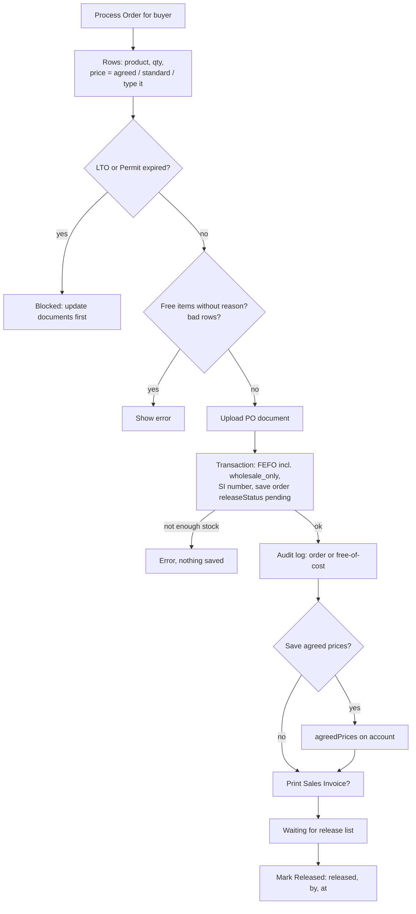

# 10 - Wholesale

**Files:** `admin/wholesale-accounts.html` + `js/admin-wholesale-accounts.js` (accounts, documents, orders, invoices,
release, exchanges, history); in `js/products-data.js`: `deductStockFEFOMultiple` with `includeWholesaleOnly`,
`processWholesaleExchange` (lines 1976-2061), `isWholesaleSellableBatch`, `wholesaleDocumentAlerts`, `wholesaleReleaseAlerts`;
`firestore.rules` (wholesaleAccounts, wholesaleOrders, wholesaleExchanges).

---

## 1. What it does and why Amson needs it

Amson also sells in bulk to **other pharmacies, clinics, hospitals and distributors**. These buyers:
- must have a valid **LTO** (License to Operate) and **Business Permit**. Selling medicines to an unlicensed business is a regulatory problem, so the system **blocks orders** when a document has expired;
- often get **agreed prices** (negotiated per buyer), or the product's standard **wholesale price**;
- may receive **free-of-cost** items (samples, donations, promos), which need a reason for accountability;
- can buy **near-expiry ("wholesale only") stock** that retail customers can't.

**Important:** wholesale buyers **don't log in** to the website. Wholesale is handled entirely by staff on this page
(the buyer orders by phone, visit or purchase order). That's why every wholesale collection is staff-only in the rules.

---

## 2. Walkthrough

### 2.1 Accounts (`saveWholesaleBtn`, `admin-wholesale-accounts.js:383-450`)

Fields: company name, contact person, business type, phone, email, address, LTO file + valid-until date, Permit file +
valid-until date, status, and the saved `agreedPrices`. Checks:
- the name is required, and **duplicate company names** are refused (`sameCompanyName`, `validators.js`, ignores capitals, spaces and dots);
- phone/email format (`contactDetailsProblem`, `validators.js:51`): phone 7-15 digits, a valid email, both optional;
- the address has no `<` `>` (`ONE_LINE_ADDRESS_PATTERN`);
- an **already-expired** document date asks for confirmation ("orders for this buyer stay blocked until it's renewed").
Documents are uploaded to Cloudinary (`kind: "document"`).

Each card shows document badges (`documentBadges`, lines 76-85) using `documentValidity` (67-74):
**expired** (red), **expiring** within 30 days (amber, `DOCUMENT_EXPIRY_WARNING_DAYS`), **missing date**, or **valid**.
Staff also get notifications for expiring/expired documents (`wholesaleDocumentAlerts`).

### 2.2 Processing an order (`confirmProcessOrderBtn`, lines 626-656)

```js
const order = readProcessOrderForm();            // 1. read the rows
if (!checkProcessOrder(account, order)) return;   // 2. check
const saved = await saveWholesaleOrder(account, order);   // 3. save + deduct stock
await logWholesaleOrder(saved, order);            // 4. audit log
if (!order.freeOfCost && savePricesTicked) await saveAgreedPrices(account, order.items);   // 5. remember prices
```

**Default price per row** (`setDefaultPrice`, lines 530-550): the buyer's **agreed price** if one exists, otherwise the
product's **standard wholesale price**, otherwise **empty with a red note** ("No wholesale price set for this product - type the price").
It never silently uses ₱0.

**`checkProcessOrder`** (677-696):
- blocks the order if the LTO or Permit is **expired**;
- free items or a free-of-cost order **need a reason**;
- every row needs a product, a whole-number qty > 0 and a unit price ≥ 0.

**`saveWholesaleOrder`** (699-750):
```js
if (selectedPoDocFile) poDocumentUrl = await uploadToCloudinary(selectedPoDocFile, { kind: "document" });   // upload first
const { invoiceNo } = await deductStockFEFOMultiple(items, {
  includeWholesaleOnly: true,
  record: { ref: orderRef, mode: "set", build: (allocations, invoiceNo) => ({
    invoiceNo, wholesaleAccountId, buyerName, items: orderItems with batches, total,
    paymentMethod: freeOfCost ? "free_of_cost" : paymentMethod, freeOfCost, freeOfCostReason, freeItemsReason,
    poRefNumber, poDocumentUrl, notes, releaseStatus: "pending", createdAt }) } });
```
- The buyer's PO document uploads **before** stock is touched, so a failed upload never leaves stock deducted.
- `includeWholesaleOnly: true` → the FEFO engine also uses `wholesale_only` (near-expiry) batches, and sells the **earliest expiry first**.
- The same **SI number series** as retail.
- `releaseStatus: "pending"` until the goods are picked up or delivered.

**Logging** (`logWholesaleOrder`, 753-778): "Wholesale Order Recorded", or **"Free-of-Cost Distribution"** with the reason, plus a separate "Wholesale Free Items" entry when only some items were free.

**Agreed prices** (`saveAgreedPrices`, 781-794): if "save these as this buyer's prices" is ticked, the prices are stored on
the account for next time (free items aren't saved), and logged.

### 2.3 Release (`markWholesaleOrderReleased`, lines 863-884)

The **"Waiting for release"** list at the top of the page shows every pending order from all buyers. **Mark Released**
saves `releaseStatus: "released"`, `releasedAt`, `releasedBy`, and logs it. Staff also get a notification for pending releases.

### 2.4 Sales Invoice PDF (`downloadWholesaleInvoice`, line 1083)

A printable invoice made with jsPDF: buyer, SI number, items, prices, total, free items marked.

### 2.5 Exchanges (`processWholesaleExchange`, `products-data.js:1997-2080`)

Same policy as walk-in: **no refunds**; replacement value must be **≥** the returned value.
In one transaction it:
- takes the replacement from stock (FEFO, wholesale batches allowed);
- returns the returned units to the batches they came from (`planBatchReturn`, latest expiry first);
- re-reads the order to make sure nobody else returned the same units ("This order was changed by someone else");
- numbers the exchange `EX-00001`, updates `returnedQty` on the order line, and saves a `wholesaleExchanges` record with the price difference.
An exchange document PDF can be printed.

---

## 3. Flowchart



---

## 4. Design decisions

| Decision | Why | Alternatives we didn't use |
| --- | --- | --- |
| Staff-only wholesale (no buyer login) | Amson's wholesale is relationship-based (calls, visits, POs); fewer accounts to secure. | A wholesale buyer portal (more security work, more support). |
| Block orders on expired LTO/Permit | Regulatory compliance; the system enforces it, not just staff memory. | A warning only. |
| Expiry stored as a date + a 30-day warning | Staff renew documents before they lapse. | Only a file upload (can't check dates). |
| Agreed prices per buyer, saved only when ticked | Negotiated prices differ per buyer; ticking avoids saving one-off prices by accident. | One wholesale price for everyone. |
| Wholesale may use near-expiry stock | Reduces Bad Order losses; buyers move stock quickly. | Writing off at 6 months. |
| Free items need a reason + their own audit entry | Free goods are a common leak; reasons make them reviewable. | Allowing ₱0 silently. |
| Upload PO document before deducting stock | A failed upload shouldn't leave stock deducted with no order. | Upload after (could leave inconsistent data). |
| Release status separate from the sale | Goods may be picked up days later; staff need a "to release" list. | Assuming released at sale time. |

---

## 5. What happens if…

1. **…a buyer's LTO expired yesterday?** The process-order form shows "This buyer's LTO has expired…", and Confirm is blocked: "Update the document and its date in Edit first."
2. **…a product has no wholesale price and no agreed price?** The price box is empty with a red note; the order can't be saved until a price is typed.
3. **…staff mark the whole order free but give no reason?** "A reason is required for a free-of-cost distribution."
4. **…there isn't enough stock (even counting near-expiry)?** The FEFO transaction fails: "Not enough stock available to fulfill this quantity." Nothing is saved.
5. **…the PO document upload fails?** The error shows; stock isn't touched because the upload happens first.
6. **…two staff record orders for the same last units?** The transaction makes the second one re-run and fail if stock is gone.
7. **…two staff process an exchange on the same order line at once?** The transaction re-reads the order; the second gets "This order was changed by someone else. Reopen it and try again."
8. **…a buyer wants to return items for a cheaper replacement?** Refused: replacement must be of equal or higher value; no refunds.
9. **…someone types phone "abc" or email "bad@"?** "Phone number: digits only, like 0917 123 4567 or (02) 8858 1000." / "Please enter a valid email address."
10. **…a second account "zuellig pharma corp." is added next to "Zuellig Pharma Corp."?** Refused: already has a wholesale account.
11. **…a customer or Sales Staff tries to read wholesale data?** Refused by the rules (`isOpsStaff()` only).

---

## 6. Security rules for this module

| Rule (`firestore.rules`) | What it blocks |
| --- | --- |
| `wholesaleAccounts` read/write `isOpsStaff()` (235) | Customers and Sales Staff seeing buyer details, documents or agreed prices. |
| `wholesaleOrders` read/create/update `isOpsStaff()`, **no delete** (236) | Deleting wholesale sales; outsiders reading them. |
| `wholesaleExchanges` ops staff, no delete (237) | Same for exchanges. |
| `productPrices` read `isStaff()` (107) | Standard wholesale prices hidden from the public. |
| `counters/salesInvoices` +1 only (318-321) | SI number tampering. |

---

## 7. Known limitations and how we'd improve them

1. **The expired-document block is in the page**, not in the rules. A console user (ops staff) could still write an order. **Improve:** a rule that reads the account's dates before allowing an order.
2. **Unit prices are typed by staff** and not checked against the standard wholesale price. **Improve:** warn on a price far below cost.
3. **Payment collection** (terms, balances) isn't tracked as receivables. **Improve:** an accounts-receivable view.
4. **Document files are on Cloudinary through an unsigned preset.** **Improve:** restrict the preset or use signed uploads.
5. **No buyer portal**, so buyers can't see their own history online (by design for now).

---

## 8. Likely panel questions

1. **"Do wholesale buyers have accounts on the website?"** No. Wholesale is staff-managed; buyers order through the branch, and staff record orders on this page.
2. **"How do you make sure buyers are licensed?"** We store the LTO and Business Permit files and their valid-until dates. Orders are blocked when either has expired (`checkProcessOrder`), and staff are alerted 30 days before.
3. **"How are wholesale prices decided?"** The buyer's agreed price if saved, else the product's standard wholesale price (from `productPrices`), else staff must type one (`setDefaultPrice`).
4. **"Why can wholesale buy near-expiry stock?"** Our policy moves batches within 6 months of expiry to "wholesale only". Buyers like clinics use them quickly, which reduces waste. The FEFO engine includes them with `includeWholesaleOnly: true`.
5. **"Do wholesale orders use a different invoice series?"** No, the same SI counter as retail, so the branch has one continuous series.
6. **"What's free-of-cost distribution and how is it controlled?"** Items given at ₱0 (samples, donations). A reason is required, and it's logged separately in the audit log.
7. **"What does 'release' mean?"** The goods were picked up or delivered. Until then, orders appear in "Waiting for release".
8. **"How are wholesale returns handled?"** Exchange only, equal or higher value, in one transaction that restocks the returned units and deducts the replacement (`processWholesaleExchange`).
9. **"Who can access this page?"** Technical Staff and the Branch Manager (UI and rules). Sales Staff can't.
10. **"Where is the buyer's PO stored?"** The file is uploaded to Cloudinary and the link saved on the order (`poDocumentUrl`), with the PO reference number.
