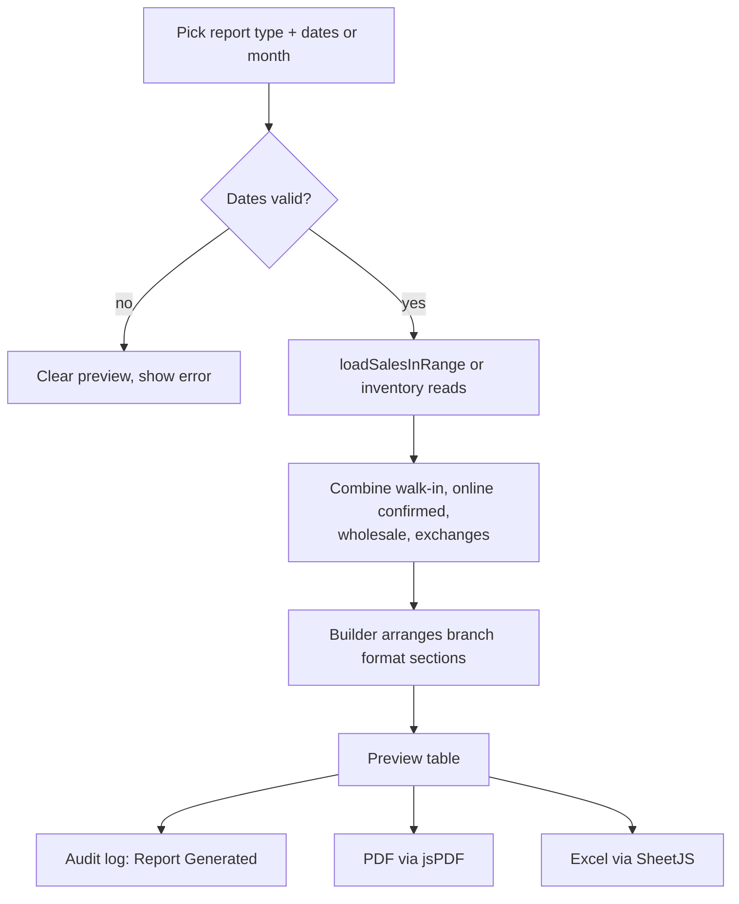
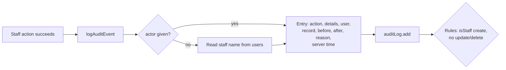

# 11 - Reports, Dashboard and Audit Log

**Files:** `admin/dashboard.html` + `js/admin-dashboard.js` (tiles, charts, most-bought, analytics export),
`admin/reports.html` + `js/admin-reports.js` (7 report types, PDF + Excel), `admin/audit-log.html` + `js/admin-audit-log.js`,
`admin/notifications.html` + `js/admin-notifications.js`, `js/admin-backup.js` (Excel/JSON backup in Settings),
`js/products-data.js` (`logAuditEvent` line 2375, `exportTable` line 1732, staff notifications 349-689),
`firestore.rules` (auditLog, notifications).

---

## 1. What it does and why Amson needs it

- **Dashboard**: the Branch Manager's morning view.
  - **Tiles**: pending verifications, active orders, low stock, near expiry, out of stock, today's POS and online sales.
  - A **sales chart** (online vs POS) for today / week / month / year, **revenue by category**, and **most-bought items**.
  - Export as PDF or Excel.
- **Reports** reproduce **the branch's own paper report formats**, so staff don't have to retype data into Excel:
  1. Daily Sales Report;
  2. Customer File (sales per customer);
  3. Monthly Inventory (per category);
  4. Supplier Purchases;
  5. Pull-Out Report (write-offs);
  6. Return/Exchange Report;
  7. Purchase Order Discrepancy Report.
  Each has a preview, a **PDF** and an **Excel** download.
- **Audit log**: a permanent, **append-only** history of important actions (who, what, when, before → after, reason).
  It's for accountability: if stock or money doesn't add up, the manager can trace who did what.
- **Notifications**: everything that needs attention, in one list and on the bell:
  - stock alerts: low stock, near expiry, expired, Bad Order to dispose;
  - online orders waiting for verification;
  - price-pending products;
  - PO discrepancies;
  - wholesale document expiry and pending releases;
  - chats waiting for staff.
- **Backup** (Settings): downloads all main collections as an Excel workbook or JSON, for the manager to keep offline.

---

## 2. Walkthrough

### 2.1 Writing to the audit log: `logAuditEvent()` (`products-data.js:2394-2420`)

```js
async function logAuditEvent({ action, details, actor, record, before, after, reason }) {
  try {
    let actorName = actor;
    if (!actorName && auth.currentUser) {
      const userDoc = await db.collection("users").doc(auth.currentUser.uid).get();
      actorName = `${userData.firstName} ${userData.lastName}`.trim() || userData.email || "Unknown";
    }
    const entry = { action, details: details || "", user: actorName || "Unknown", ipAddress: "-", createdAt: serverTimestamp() };
    if (record) entry.record = String(record);
    if (before != null && before !== "") entry.before = String(before);
    if (after != null && after !== "") entry.after = String(after);
    if (reason) entry.reason = String(reason);
    await db.collection("auditLog").add(entry);
  } catch (error) { console.error("Failed to write audit log entry:", error); }
}
```
- Called after every important action: sales, voids, exchanges, approvals, holds, dispatch, stock received, write-offs, counts, price changes, categories, wholesale orders, staff changes, reports generated.
- `actor` can be passed in (e.g. `"System"` for automatic expiry moves); otherwise it uses the logged-in staff member's name.
- `createdAt` is the **server** time, so a wrong computer clock can't fake when something happened.
- Wrapped in `try/catch` so a logging failure never breaks the sale itself.
- `ipAddress` is "-": a browser can't reliably know its own public IP without a server.

### 2.2 The audit log page (`js/admin-audit-log.js`)

- Loads all entries newest first: `.orderBy("createdAt", "desc")` (line 25).
- Search across user, action, details, record, before, after and reason; filter by date range using **local** midnight (lines 34-57).
- Every value is shown through `escapeHtml` (`renderAuditRow`, 84-101).
- **Export** to PDF/Excel with `exportTable` (lines 156-174): exactly the rows currently filtered.

### 2.3 Dashboard (`js/admin-dashboard.js`)

1. On `admin:ready`, `loadDashboardStats()` (lines 191-241):
   - reads orders and walk-in sales (as live queries) plus the catalog;
   - **voided walk-in sales are removed** (`.filter((s) => !s.voided)`);
   - runs `enforceExpiryStatus()` (module 08);
   - computes the tiles with `computeInventoryAlertCounts()`;
   - today's POS sales = walk-in sales created today (local day, `isToday`); today's online sales = **confirmed** orders created today (`isConfirmedSale`: not `placed`, not `closed_unresolved`).
2. The order tiles then **update live** (`watchOrderTilesLive`, lines 12-25).
3. **Sales chart** (`renderSalesChart`, 263-316): `totalsByBucket` groups totals by day/week/month depending on the period; Chart.js draws two lines, Online (red) and POS (blue). The old chart is destroyed before drawing a new one (otherwise Chart.js stacks charts).
4. **Revenue by category** (doughnut) and **Most-bought items** (lines 320-458), with Excel export (`XLSX.utils.json_to_sheet`, lines 612-634).

### 2.4 Reports (`js/admin-reports.js`)

`generateReport()` (lines 919-962):
```js
if (REPORT_TYPES[type].range === "dates") {
  if (!reportFromInput.value || !reportToInput.value) throw new Error("Pick a start and end date.");
  const start = parseLocalDate(reportFromInput.value);
  const toDay = parseLocalDate(reportToInput.value);
  if (toDay < start) throw new Error("The end date is before the start date.");
  const end = new Date(toDay.getFullYear(), toDay.getMonth(), toDay.getDate() + 1);   // include the whole last day
  report = await { daily_sales: buildDailySalesReport, ... }[type](start, end);
}
...
reportPreview.innerHTML = renderReportPreview(report);
logAuditEvent({ action: "Report Generated", details: ... });
```
- The **object lookup** `{ daily_sales: fn, ... }[type]` picks the right builder function by name.
- `end` is the day **after** the chosen end date, and queries use `< end`, so the whole last day is included.
- If anything fails, the preview is cleared (so an old report isn't mistaken for a new one) and the error shows.

**Getting all sales in a range** (`loadSalesInRange`, lines 48-121) combines **all channels** into one shape:
- walk-in sales by `createdAt`, skipping voided ones;
- online orders by **`statusTimestamps.payment_confirmed`** (a sale counts when payment is confirmed), skipping closed ones; the total includes store credit used;
- wholesale orders by `createdAt`;
- exchanges on their own day (the returned item as a negative line, the replacement as positive).

The builders (`buildDailySalesReport`, `buildMonthlyInventoryReport`, …) arrange these into **sections** that match the paper forms.
`downloadReportPdf` (714) draws them with jsPDF; `downloadReportExcel` (833-863) writes one sheet per section with SheetJS.
`pdfSafeText` (`products-data.js:1307`) swaps "₱" for "PHP " because jsPDF's built-in fonts can't draw the peso sign.

### 2.5 Staff notifications (`products-data.js:349-689`, `admin-header.js:98-211`)

`computeStaffNotifications()` (line 421) builds the alert list from batches, orders, POs, products, wholesale data and chats.
- Each alert has a `key` and a `signature`. "Read" is stored per staff member in `notifications/{uid}.read[key] = signature` (`markStaffNotifRead`, 673-677). If the situation changes (e.g. the stock count changes), the signature changes and the alert shows as **unread** again.
- The list is cached for 2 minutes (`STAFF_NOTIF_CACHE_MS`) to save reads. Live listeners add **new orders** and **waiting chats** instantly (`watchStaffAlertsLive`, `admin-header.js:179-211`).
- If the browser allows it, staff also get **desktop pop-ups** (`showBrowserAlerts`, `admin-header.js:224-246`).

---

## 3. Flowcharts

### Report generation


### Audit log entry


---

## 4. Design decisions

| Decision | Why | Alternatives we didn't use |
| --- | --- | --- |
| Reports built in the browser from Firestore | No server needed; data is small enough for one branch. | A reporting server or BigQuery (cost, complexity). |
| Match the branch's existing paper formats | Staff and the owner already know them; easier acceptance. | Our own report layouts. |
| A sale counts on its **payment-confirmed** date | Unverified orders aren't sales yet; matches the SI number date. | Order-placed date. |
| Voided sales excluded but kept | Totals stay correct and the record stays for audit. | Deleting voided sales. |
| Audit log append-only in the rules | Nobody, not even the Branch Manager, can edit or delete history. | Editable logs (worthless as evidence). |
| Before / after / reason fields | The manager sees exactly what changed and why. | A free-text description only. |
| Notification read state by signature | An alert comes back if things change again (e.g. stock drops further). | A simple "read" flag (would hide new problems). |
| Excel + PDF exports | PDF for printing/signing, Excel for the owner's own analysis. | One format only. |
| Backup download | The free plan has no automatic Firestore backups. | Paid scheduled exports. |

---

## 5. What happens if…

1. **…the end date is before the start date?** "The end date is before the start date." The preview is cleared.
2. **…a sale is voided after the report was printed?** The next report leaves it out (`if (sale.voided) return;`). The void is in the audit log.
3. **…an online order is placed on Monday and confirmed on Tuesday?** Reports count it on **Tuesday** (payment-confirmed date). The dashboard's online chart groups confirmed orders by the date they were **placed**, so the two can differ by a day.
4. **…someone tries to delete an audit log entry from the console?** Refused: `allow update, delete: if false` (`firestore.rules:250`). (Exception: the temporary Clear Test Data rule until 15 Nov 2026, Branch Manager only.)
5. **…the audit log write fails (e.g. internet drops right after a sale)?** The sale is already saved; `logAuditEvent` catches the error and logs it to the console. The sale record itself (with cashier, SI number, items) still exists.
6. **…Sales Staff try to open Reports or the Audit Log?** Sent back to the POS; the rules refuse `auditLog` reads for them.
7. **…a customer tries to write a fake audit entry?** Only two actions are allowed for customers ("Order Received by Customer", "Order Auto-Delivered"), with a short detail and the server time (`firestore.rules:245-249`).
8. **…there are no sales in the chosen period?** The chart shows its empty state; reports show empty sections.
9. **…jsPDF or SheetJS failed to load (no internet)?** "PDF generation isn't available right now…" / "Excel export isn't available right now…"
10. **…a product's name changed after it was sold?** Reports use the name saved on the sale line, so old reports stay accurate.

---

## 6. Security rules for this module

| Rule (`firestore.rules`) | What it blocks |
| --- | --- |
| `auditLog` read `isOpsStaff()` (241) | Customers and Sales Staff reading the history. |
| `auditLog` create `isStaff()` (243) | Outsiders writing entries. |
| customer create only 2 actions, fixed keys, ≤ 201 chars, `createdAt == request.time` (245-249) | Customers spamming or faking history, or back-dating entries. |
| `auditLog` update/delete `false` (250) | Editing or erasing history. |
| `notifications` ops staff only (253) | Others reading or changing staff read-states. |
| Reads of `orders`, `posSales`, `wholesaleOrders`, `batchCosts`… ops staff only | Sales Staff and customers generating reports with private data. |

---

## 7. Known limitations and how we'd improve them

1. **The audit log's `user` name comes from the browser.** Entries can't be edited later, but a staff member using the console could write an entry with a fake name. **Improve:** save the uid too and check it in the rules (`request.resource.data.uid == request.auth.uid`).
2. **IP address isn't recorded** (shown as "-"). **Improve:** a Cloud Function could record it.
3. **Reports read whole collections** (e.g. all stock batches); fine for one branch but slower as data grows. **Improve:** pre-computed daily totals.
4. **Dashboard and reports can differ slightly for online sales:** the dashboard groups by the order date and uses the amount paid; reports use the payment-confirmed date and include store credit.
5. **The audit log page loads every entry at once.** **Improve:** pagination with `limit()`.
6. **Backups are manual downloads.** **Improve:** scheduled exports (Blaze plan).

---

## 8. Likely panel questions

1. **"Can the Branch Manager delete or edit the audit log?"** No. The rules allow create only, never update or delete (`firestore.rules:250`). (The temporary clear-test rule ends 15 Nov 2026.)
2. **"What's recorded in each audit entry?"** Action, details, the staff member's name, the record affected, before, after, reason, and server time (`logAuditEvent`, `products-data.js:2394`).
3. **"Why use the server timestamp?"** So a wrong or tampered computer clock can't change when something happened.
4. **"How do your reports match the branch's formats?"** Each builder arranges the data into the same sections and columns as the branch's paper reports, then exports the same structure to PDF and Excel.
5. **"When is an online order counted as a sale?"** When staff confirm the payment; that's also when it gets its SI number.
6. **"How are voided sales handled in reports?"** They're kept in the database with `voided: true` and skipped in totals.
7. **"How does the dashboard update?"** Order tiles listen live; the rest loads when the page opens; charts redraw when you change the period.
8. **"How does a staff member know something needs attention?"** The bell and Notifications page list alerts computed from live data; new orders and waiting chats appear instantly.
9. **"What library draws the charts?"** Chart.js (`new Chart(canvas, {...})`, `admin-dashboard.js:286`).
10. **"How do you make PDFs and Excel files without a server?"** jsPDF and SheetJS run in the browser; `createPdf` and `exportTable` in `products-data.js` wrap them.
11. **"What if the internet goes down? Is data lost?"** Firestore keeps the data on Google's servers; the manager can also download a backup from Settings (`admin-backup.js`).
