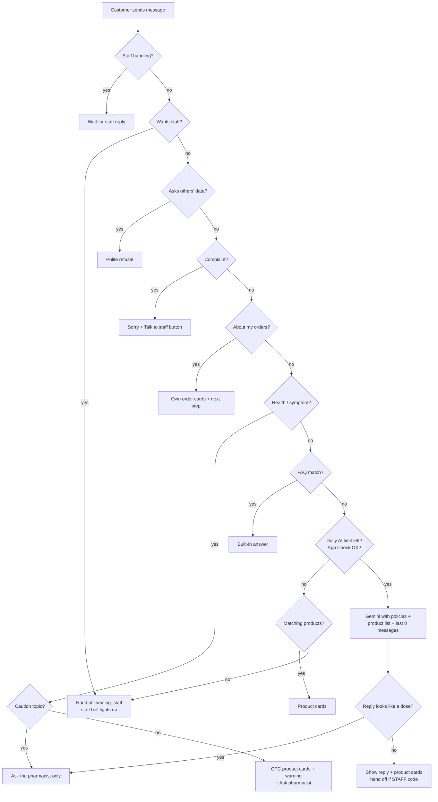

# 12 - Live Chat and the AI Assistant

**Files:** `js/live-chat.js` (the customer chat widget on shop pages, the answer pipeline, Gemini calls), `js/chat-config.js`
(model, daily limit, App Check key), `admin/live-chat.html` + `js/admin-live-chat.js` (staff inbox), `js/store-info.js`
(store hours and contact used in answers), `firestore.rules` (chatThreads, messages, chatUsage).

---

## 1. What it does and why Amson needs it

- A **"Chat with us"** button on every shop page. Customers (and guests) can ask about store hours, delivery, payment, prescriptions, their orders, or products.
- Many questions are answered **instantly without staff**:
  1. **built-in answers** for common questions (FAQ);
  2. **order cards** showing the customer's own orders and what happens next;
  3. **product cards** for products in stock, with Add to Cart;
  4. **safe health replies**: what OTC products we carry for a symptom, **always** with "ask our pharmacist"; never doses or diagnoses;
  5. **Google Gemini** for everything else, limited to Amson's policies and real product data.
- Anything the assistant can't handle, or any "talk to staff", is **handed off** to a human in **Admin → Live Chat**.
- Why: a small branch can't answer chats all day. The assistant handles routine questions, and staff focus on real problems, while patient safety (no medical advice) is protected.

---

## 2. Walkthrough

### 2.1 Who is chatting? (`live-chat.js:818-857`)

- A **logged-in customer** gets the thread id `cust_<uid>`, so their chat follows them across devices.
- A **guest** gets `guest_` + 24 random characters, made with `crypto.getRandomValues` and kept in localStorage.
- The thread (`chatThreads/{id}`) and its `messages` are **listened to live**, so staff replies appear instantly.

### 2.2 Sending a message (`send`, `live-chat.js:1237-1276`)

```js
text = String(text || "").trim().slice(0, CHAT_MAX_LENGTH);          // max 500 characters
if (sending || Date.now() - lastSentAt < CHAT_MIN_GAP_MS) {          // 1.5 s between messages
  sendRetryTimer = setTimeout(() => send(text), ...);                // wait, then send it (not dropped)
  return;
}
await identityReady;            // know who's chatting first
await touchThread(text);        // create/update the thread (status "ai" for new ones)
await addMessage("customer", text);
if (!thread || !["staff", "waiting_staff"].includes(thread.status)) { thinking = true; renderMessages(); }   // "..." typing dots
await respond(text);
```

### 2.3 Choosing the answer: `respond()` (`live-chat.js:1118-1165`)

The order matters. **Safety checks come first, and the AI comes last:**

| # | Check | Function | Result |
| --- | --- | --- | --- |
| 0 | Staff already handling this chat? | `status === "staff"` or `"waiting_staff"` | Do nothing; staff will answer. |
| 1 | Asked for a person? ("talk to staff", "pharmacist", "tao"…) | `chatWantsStaff` (111) | **Hand off** to staff. |
| 2 | Asking for **other people's** details? | `chatAsksOthersData` (117) | Polite refusal; never shares others' data. |
| 3 | Complaint (wrong/damaged item, "reklamo")? | `chatHasComplaint` (124) | Apology + "Talk to staff" button. |
| 4 | About **my orders**? | `chatWantsOrders` (335) | `answerOrders`: cards of *your own* orders and next steps. |
| 5 | Health/symptom question? | `chatIsHealthQuestion` (155) / `chatSymptomsIn` | `answerHealth`: safe template + OTC products + "Ask our pharmacist". |
| 6 | Short, clear common question? | `chatMatchFaq` (130) | Built-in answer (no AI used). |
| 7 | Anything else | `askAssistant` (1168) | Ask Gemini. |

All word lists include **English and Filipino/Taglish** ("gamot sa", "lagnat", "kausap", "may tao ba").

### 2.4 Health questions: `answerHealth` (`live-chat.js:1028-1073`)

- **Caution topics** (children, pregnancy, breastfeeding, doses, other medicines, long-term conditions) → **only** the safe "please ask our pharmacist/doctor" message (`chatHasHealthCaution`).
- Otherwise it maps the symptoms to label words. It uses the built-in symptom list first, and the AI "reader" model only if the list didn't recognize anything.
- It then shows **OTC products in stock whose labels match**, with a warning and the "Ask our pharmacist" button. It **never** says how much or how often to take.

### 2.5 Asking Gemini: `chatAiReply` (`live-chat.js:569-628`)

1. **Load the model only when needed** (`loadGeminiModel`, 478-485): it imports the newer Firebase modular SDK and Firebase AI Logic from Google's CDN, creates a separate app named `amson-chat`, and turns on **App Check** with reCAPTCHA Enterprise (`getChatFirebaseApp`, 455-475). **There's no Gemini API key in our code.**
2. **Daily limit** (`claimChatAiQuota`, 556-566): a transaction on `chatUsage/<today>`. If the count reached `dailyAiLimit` (400; the free tier is about 500/day), the AI isn't called and the chat goes to staff.
3. **The prompt:**
   - the **system instruction** (`chatSystemInstruction`, 432-449) holds the store policies (QR Ph only, Lalamove, Rx pick-up only, no refunds, 7-day holds, no near-expiry online) and strict rules: never medical advice or doses; only mention products from the given list; never share other people's data; reply with `[[STAFF]]`, `[[HEALTH]]` or `[[ORDERS]]` codes when needed;
   - up to the **last 8 messages** (`historyMessages: 8`);
   - the question with "[Reply in English/Filipino]";
   - a **product list** (up to 8 matching products, with price and stock) so the AI can't invent products or prices.
4. **Settings:** `maxOutputTokens: 300`, `temperature: 0.3` (short, predictable answers).
5. **Busy (rate-limited)?** Wait 5 s and try once more.
6. **Reading the answer:** `[[HEALTH]]` → `answerHealth`; `[[ORDERS]]` → `answerOrders`; `[[STAFF]]` → reply and hand off.

### 2.6 After the AI answers: the safety net (`askAssistant`, `live-chat.js:1197-1202`)

```js
if (reply && reply.text && chatLooksLikeDosage(reply.text)) {
  await addMessage("assistant", CHAT_HEALTH_TEXT[lang].none, [{ type: "button", label: "Ask our pharmacist", ... }]);
  return;
}
```
Even if someone tricks the AI, any reply that **looks like a dose** is thrown away and replaced with the safe pharmacist message. `CHAT_DOSAGE_PATTERNS` (lines 15-22) catch things like "take 2 tablets", "every 6 hours", "3 times a day", "500 mg per kg", "2 teaspoons" (also in Filipino).

### 2.7 When the AI can't answer (`askAssistant`, 1216-1233)

- If products match the question (or a follow-up like "can I order that?"), show **product cards**.
- Otherwise **hand off**: "Our assistant can't answer that right now, so I've passed your chat to our staff…" (reason `ai_limit` or `ai_unavailable`).

### 2.8 Hand-off and the staff side

- `handOffToStaff` (`live-chat.js:1106-1115`): status → `waiting_staff`, `unreadByStaff: true`, `handoffReason`, then a system message to the customer. The staff bell lights up instantly (`watchStaffAlertsLive` listens to `waiting_staff` threads).
- **Staff inbox** (`admin-live-chat.js`):
  - **live list** of threads, newest first (`listenToThreads`, 52-68);
  - **reply** (173-201): adds a `staff` message and sets status `staff`, so the AI stops answering this chat;
  - **hand back to assistant** (203-216);
  - **resolve** (218-235);
  - **today's AI count** shown at the top ("AI replies today: N of 400").
- The customer can tap **"Back to assistant"** while waiting (`live-chat.js:1303-1316`).

---

## 3. Flowchart



---

## 4. Design decisions

| Decision | Why | Alternatives we didn't use |
| --- | --- | --- |
| Rules first, AI last | Free, instant and predictable for common questions; saves the AI's daily quota; safety checks can't be skipped by the AI. | Sending everything to the AI (costly, less predictable). |
| Never give doses or diagnoses; filter AI output | Patient safety and pharmacy regulations: only a pharmacist/doctor advises. | Trusting the AI's instructions alone (can be tricked). |
| Product list given to the AI | The AI can only mention real products, prices and stock; no made-up items. | Letting the AI answer from general knowledge. |
| Gemini through Firebase AI Logic + App Check | No API key in our code; App Check stops other sites from using our quota. | Calling the Gemini API with a key in the browser (key would leak). |
| Daily cap (400) in Firestore | Stays inside the free tier; when reached, chats go to staff instead of failing. | No cap (bills or errors). |
| Hand-off to humans | Complaints, payments and anything unclear need a person. | AI-only support. |
| Guest chats with a random id | Customers can ask before signing up; the random id makes guessing someone else's chat impractical. | Requiring login to chat. |
| English + Filipino word lists | Amson's customers write in Taglish. | English only. |

---

## 5. What happens if…

1. **…a customer asks "how many paracetamol should I take for my child?"** The health check catches it as a **caution** topic (child + dose) → only the "please ask our pharmacist/doctor" message with the pharmacist button.
2. **…someone tricks the AI into giving a dose?** `chatLooksLikeDosage` catches dose patterns in the reply and replaces it with the safe message.
3. **…someone asks "what is the address of your other customers?"** `chatAsksOthersData` → "Sorry, I can't share other customers' or staff members' personal information."
4. **…the daily AI limit is reached?** `claimChatAiQuota` returns false → product cards if any match, otherwise hand-off to staff ("ai_limit"). Staff see the count at the top of Live Chat.
5. **…App Check fails (e.g. localhost without a debug token, or a domain not on the reCAPTCHA key)?** The Gemini call fails → the chat hands off to staff with "Our assistant can't answer that right now…". This is what happened during testing on localhost.
6. **…a customer sends two messages within 1.5 seconds?** The second waits and is sent after the gap (fixed during testing; it used to be dropped).
7. **…someone floods messages from a script?** The rules limit each message to 2,000 characters and only allowed fields; the page limits 500 characters and 1.5 s per message. A determined script could still post many messages into its *own* thread.
8. **…a guest tries to read another guest's chat?** They'd need the exact 24-character random id. A customer can only open `cust_<their own uid>`. Staff can list threads; customers can't (`list` is ops staff only).
9. **…a customer tries to take the chat back from staff via the console?** Refused: once `status` is `"staff"`, customers can't change it (`firestore.rules:285`).
10. **…the AI is turned off (`aiProvider: "none"`)?** The chat still works with built-in answers, order cards, product cards, health templates and staff hand-off.
11. **…staff reply while the customer is offline?** The message is saved; the customer sees it next time they open the chat (live listener).
12. **…the customer asks "where is my order?"** `chatWantsOrders` → cards of *their own* orders (read under the normal orders rules) with status and next step, including the Lalamove tracking link if dispatched.

---

## 6. Security rules for this module

| Rule (`firestore.rules`) | What it blocks |
| --- | --- |
| `chatThreadIsMine`: id is `guest_` + 24 letters/digits, or `cust_` + your uid (266-269) | Customers opening other customers' chats by id. |
| thread `get`: ops staff or owner; `list`: ops staff only (272-273) | Customers listing all chats. |
| thread create: `status "ai"`, own `customerId` or none, only allowed keys, short strings (275-279) | Creating chats pretending to be another customer, or with junk fields. |
| `chatThreadTextOk`: lastMessage ≤ 201, name ≤ 101, reason ≤ 101 (257-264) | Filling the database with huge text. |
| customer update: only chat fields; status only `ai` / `waiting_staff` / unchanged; never away from `staff` (281-286) | Customers marking chats resolved or stealing them back from staff. |
| messages: owner or ops staff read; customer side creates `customer`/`assistant`/`system` only, text ≤ 2,0, cards ≤ 20; no edit/delete (288-299) | Long spam messages; editing history; posting as "staff". |
| `chatUsage`: create = 1, update = +1, only `count, updatedAt` (303-309) | Resetting or jumping the daily AI counter. |

---

## 7. Known limitations and how we'd improve them

1. **Anyone can use up the daily AI counter** (it can be raised by 1 at a time by anyone, so a script could reach 400). The chat then hands off to staff; no data is at risk. **Improve:** count per user, or check quota on a server.
2. **Customers can post messages labelled "assistant" or "system" in their own chat** (the rules allow it, because the assistant runs in their browser). Staff should know an "assistant" line could be faked. **Improve:** run the assistant on a server (Cloud Function) and only allow `customer` messages from browsers.
3. **The AI's safety depends on instructions plus our dose filter.** The filter catches common dose patterns, not every possible wording. Caution topics never reach the AI's free text.
4. **App Check on localhost needs a debug token** registered in the Firebase console, per browser.
5. **Rate limiting is client-side** (1.5 s gap, 500 chars). **Improve:** server-side limits.
6. **Free tier limits** (~500 requests/day) cap growth. **Improve:** paid plan if usage grows.

---

## 8. Likely panel questions

1. **"Does your AI give medical advice?"** No. Health questions are answered with fixed safe templates and OTC product suggestions plus "ask our pharmacist". Caution topics (children, pregnancy, doses, other medicines) get only the pharmacist message. Any AI reply that looks like a dose is replaced (`chatLooksLikeDosage`).
2. **"Where's your Gemini API key?"** There isn't one in the code. We use Firebase AI Logic, which holds the key on Google's side, and App Check proves requests come from our site (`live-chat.js:455-485`).
3. **"What's App Check doing here?"** It gives each request a reCAPTCHA-based token proving it came from our real website, so others can't use our AI quota by copying our config.
4. **"How do you stop the AI from inventing products or prices?"** We send it a list of real matching products with price and stock, and instruct it to mention only those (`chatAiReply`, line 588-599).
5. **"What happens when the AI is down or the limit is reached?"** It falls back to product cards or hands the chat to staff. Nothing breaks.
6. **"Why answer with rules before the AI?"** Faster, free, predictable, and it saves the daily quota. Safety-critical cases never depend on the AI.
7. **"How does staff take over a chat?"** Replying sets the thread status to `staff`; the assistant stops answering that chat until staff hand it back or resolve it.
8. **"Can guests chat?"** Yes, with a random `guest_` id stored in their browser.
9. **"How do staff know a chat needs them?"** Hand-off sets `waiting_staff`; the staff bell listens to those threads live and shows an alert immediately.
10. **"How many messages does the AI remember?"** The last 8 since the last hand-over (`historyMessages: 8`), to keep requests small.
11. **"Does it understand Filipino?"** Yes. Word lists include Filipino/Taglish, and we tell the AI to reply in the customer's language.
12. **"What stops someone from reading another person's chat?"** Thread ids are `cust_<uid>` (checked against the login) or a 24-character random guest id; listing all threads is staff-only.
